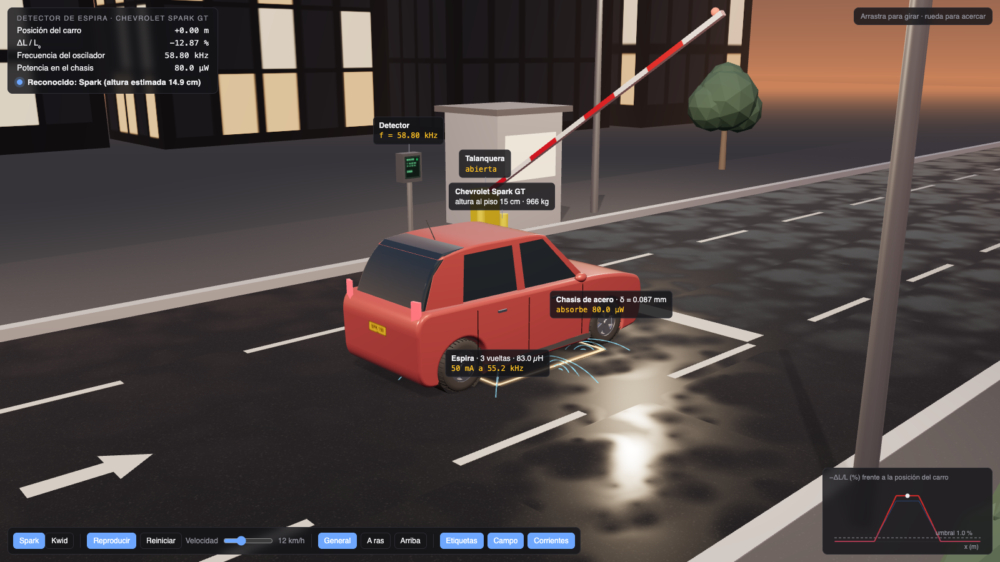
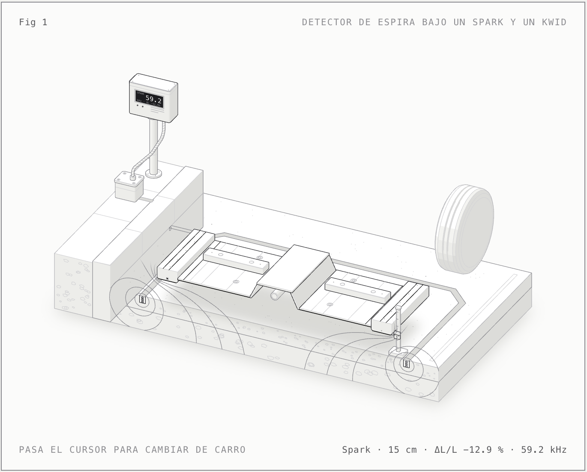
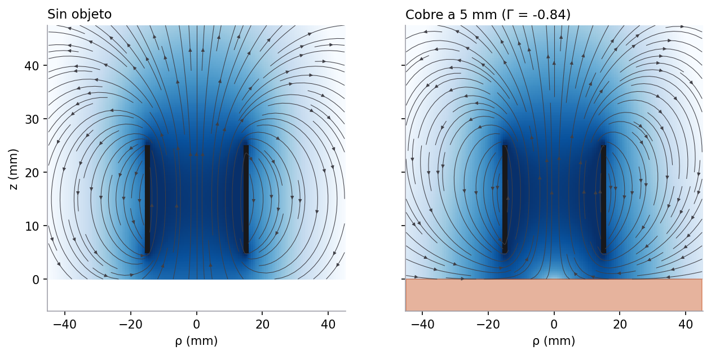

# Simulador de sensor electromagnético de proximidad

**SEMP** · Proyecto final de **Electromagnetismo**: diseño y simulación de un sensor electromagnético de
proximidad, el dispositivo que en las líneas de producción detecta piezas metálicas sin tocarlas.

El simulador modela una bobina alimentada con corriente cuyo campo magnético induce **corrientes de Foucault**
en una pieza cercana. Esas corrientes, por la ley de Lenz, cambian la inductancia y la resistencia de la bobina, y
con ellas la corriente del circuito. El sensor compara esa corriente con la que habría sin pieza y se activa
cuando la diferencia supera un umbral. Además, por la fase y la magnitud de ese cambio, identifica **de qué metal**
es la pieza y **a qué distancia** está.



| Figura del informe (Anatomy) | Campo calculado por el modelo |
|---|---|
|  |  |

## Esquema del proyecto: D.E.P.A.

El proyecto sigue el esqueleto propuesto por el profesor ([orientación](docs/enunciado/orientacion-profesor.md)):

| Etapa | En el sensor |
|---|---|
| **Insumos** | Contextos de aplicación. Caso principal: espira en el piso de un parqueadero que reconoce un **Chevrolet Spark GT** o un **Renault Kwid**. Segundo escenario: línea de autopartes con piezas de distintos metales |
| **D · Detección** | ¿Hay carro? ¿Cuál es? (la distancia que importa es la altura del chasis: 15 cm el Spark, 18 cm el Kwid) |
| **E · Emisiones** | El chasis de acero responde con corrientes de Foucault que bajan la inductancia de la espira |
| **P · Propiedades** | Frecuencia del oscilador (55 kHz, δ = 0.09 mm en el acero), potencia y energía; solo Faraday y Ampère |
| **A · Alerta** | El oscilador sube su frecuencia; si supera el umbral se abre la talanquera y se registra el modelo |
| **Solución** | Spark: ΔL/L = −12.9 %, Kwid: −11.4 %; cada carro se reconoce por su altura estimada |

Detalle en [docs/00-modelo-teorico-depa.md](docs/00-modelo-teorico-depa.md).

## Qué hace el proyecto

- **Física desde las ecuaciones de Maxwell.** Faraday, Ampère y Gauss magnética, en régimen cuasi-estático.
  El efecto de la pieza se calcula con el modelo de Dodd y Deeds (1968), que tiene en cuenta la conductividad,
  la permeabilidad, la distancia y la frecuencia.
- **Circuito RL resuelto como el RC de clase.** Ley de mallas de Kirchhoff, separación de variables, constante
  de tiempo τ = L/R y el 63 % en t = τ, tanto al energizar con corriente continua como con alimentación alterna.
- **Euler y Runge–Kutta 4 programados a mano**, comparados con la solución exacta y con SciPy. Los órdenes de
  convergencia medidos son 1.01 y 4.02, frente a los teóricos 1 y 4.
- **Simulador interactivo** en el navegador, donde se cambian las espiras, la frecuencia, la distancia y el
  material, y se ven la señal de salida y el umbral de detección.

## Resultados principales

| Resultado | Valor |
|---|---|
| Inductancia de la bobina de referencia (150 espiras, radio 15 mm) | 0.60 mH |
| Cambio de inductancia con cobre a 5 mm / con acero a 5 mm | −8.5 % / +5.5 % |
| Alcance de detección con cobre (umbral del 2 %) | 6.1 mm |
| Profundidad de penetración en cobre a 1 kHz | 2.1 mm |
| Mejora de RK4 al dividir el paso entre 2 | 16 veces menos error |
| Balance de energía en la solución numérica | error de 5×10⁻⁷ |

Otros hallazgos:

- El **acero** aumenta la inductancia a baja frecuencia porque se magnetiza, y la disminuye a alta frecuencia.
  Cerca de 20 kHz los dos efectos se cancelan y el sensor no lo detecta (**frecuencia ciega**).
- El **alcance** es del orden del radio de la bobina, porque de lejos la bobina es un dipolo magnético cuyo campo
  cae como 1/z³.
- Si los metales se ordenan por **pérdidas de energía** en la pieza, el modelo reproduce el orden de detección
  que publican los fabricantes de sensores comerciales.

## El simulador

| Pestaña | Qué muestra |
|---|---|
| **Caso: vehículo** | **Escena 3D** del parqueadero (Three.js): el carro se detiene sobre la espira, el detector lo reconoce y la talanquera se abre, con líneas de campo y corrientes de Foucault. Además, señal al cruzar, cambio de inductancia según la altura del chasis y alerta de talanquera |
| **Modelo** | Inductancia y resistencia efectivas frente a la distancia para cinco materiales, curva de detección con el umbral y efecto de la frecuencia |
| **Respuesta temporal** | Corriente en el tiempo con la solución exacta, RK4, Euler y SciPy; en modo DC, la curva del 63 % |
| **Paso del objeto** | Una pieza que pasa por una banda transportadora y la salida ON/OFF del sensor, con histéresis |
| **Identificación** | El caso de estudio D.E.P.A.: material y distancia de la pieza en el plano de impedancia, aviso de impurezas y matriz de confusión |
| **Campo** | Líneas del campo magnético y su intensidad, con la pieza y la profundidad de penetración |
| **Validación** | Error frente al paso temporal, orden de convergencia y límites de estabilidad |
| **Derivación** | La deducción simbólica con SymPy |
| **Análisis** | Interpretación física, comparación de materiales, rendimiento en la línea de producción y limitaciones |

Tiene tema claro y oscuro, y alimentación alterna o escalón DC.

## Cómo ejecutarlo

Requiere Python 3.9 o superior.

```bash
python3 -m venv .venv
.venv/bin/pip install -r requirements.txt
.venv/bin/streamlit run app.py
```

Se abre en el navegador en `http://localhost:8501`.

Pruebas automáticas y figuras del informe:

```bash
.venv/bin/python -m pytest -q tests
.venv/bin/python scripts/generar_figuras.py
```

## Informe

El informe completo está en [`docs/`](docs/README.md), con un documento por cada criterio de la rúbrica:

| Criterio | Peso | Documento |
|---|---|---|
| Esqueleto del proyecto (D.E.P.A.) | – | [00 · Modelo teórico y formalismo](docs/00-modelo-teorico-depa.md) |
| Fundamentación física | 15 % | [01 · Fundamentación física](docs/01-fundamentacion-fisica.md) |
| Modelamiento analítico | 20 % | [02 · Modelamiento analítico](docs/02-modelamiento-analitico.md) |
| Métodos numéricos | 20 % | [03 · Métodos numéricos](docs/03-metodos-numericos.md) |
| Programación | 10 % | [04 · Programación](docs/04-programacion.md) |
| Simulación | 15 % | [05 · Simulación](docs/05-simulacion.md) |
| Validación e impacto | 10 % | [06 · Validación e impacto](docs/06-validacion-e-impacto.md) |
| Sustentación | 10 % | [07 · Sustentación](docs/07-sustentacion.md) |
| Uso de IAG | – | [08 · Uso de IAG](docs/08-uso-de-iag.md) |

El enunciado del curso y la guía con la rúbrica están en [`docs/enunciado/`](docs/enunciado/).

## Estructura del código

| Archivo | Contenido |
|---|---|
| `sensor/physics.py` | Inductancia de la bobina (Wheeler), modelo de Dodd–Deeds, profundidad de penetración y campo magnético (Biot–Savart con integrales elípticas) |
| `sensor/numerics.py` | Euler y RK4 a mano, soluciones exactas AC y DC, estudio de convergencia, pieza en movimiento con L(t) variable, demodulador y comparador con histéresis |
| `sensor/vehiculo.py` | Espira de parqueadero, datos del Spark y el Kwid, paso del carro y reconocimiento por altura |
| `sensor/identificacion.py` | Identificación del material y la distancia en el plano de impedancia, residuo de impurezas y evaluación Monte Carlo |
| `sensor/symbolic.py` | Deducción con SymPy de la ecuación del circuito, su solución, la impedancia, la energía y las sensibilidades |
| `app.py`, `ui.py` | Interfaz del simulador y temas claro y oscuro |
| `scripts/generar_figuras.py` | Figuras del informe en `docs/figuras` |
| `tests/test_modelo.py` | 11 pruebas: convergencia, límites físicos, 63 % en τ, energía, campo dipolar, identificación y carros |

## Modelo en resumen

- Inductancia sin pieza: L₀ = μ₀N²πa² / (l + 0.9a)
- Cambio por la pieza: ΔZ = jωπμ₀a²N² ∫ J₁²(αa) Γ(α) F²(α) dα, con Γ = (μᵣα − α₁)/(μᵣα + α₁) y α₁ = √(α² + jωμ₀μᵣσ)
- Parámetros efectivos: L_eff = L₀ + Im(ΔZ)/ω, R_eff = R₀ + Re(ΔZ)
- Circuito: ε − iR − L di/dt = 0
- Detección: |Iₚ − Iₚ,₀| / Iₚ,₀ ≥ umbral

## Referencias

- C. V. Dodd y W. E. Deeds, "Analytical solutions to eddy-current probe-coil problems", *Journal of Applied Physics* 39, 2829 (1968).
- H. A. Wheeler, "Simple inductance formulas for radio coils", *Proceedings of the IRE* 16, 1398 (1928).
- D. J. Griffiths, *Introduction to Electrodynamics*, 4.ª ed.
- Apuntes de clase del curso de Electromagnetismo.

## Equipo

Luis Ernesto Rodriguez, Sebastian Santander Soto, Kevin Lozano Gomez, Juan Pablo Corchuelo y Mateo Lopez
