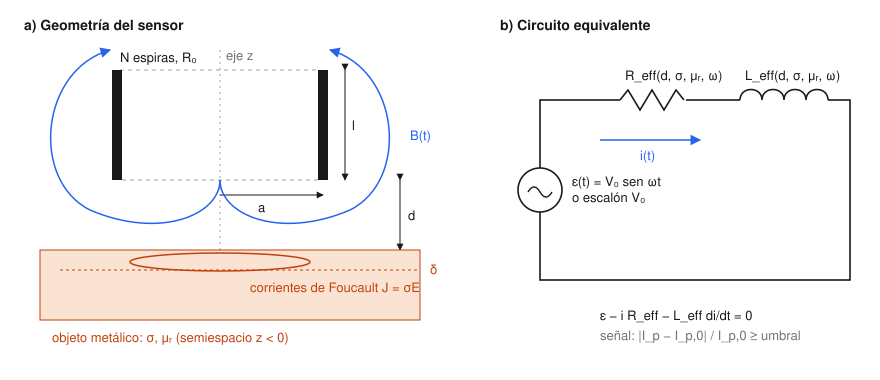

# 1. Fundamentación física

> Criterio de la rúbrica: **Fundamentación física (15 %)**, aplicación correcta de las ecuaciones de Maxwell.

## 1.1 Descripción del fenómeno

Un sensor inductivo de proximidad es una bobina alimentada con corriente. La corriente crea un campo
magnético $\vec B(t)$ alrededor de la bobina. Cuando una pieza metálica entra en ese campo, pasa lo siguiente:

1. El flujo magnético que atraviesa la pieza cambia en el tiempo y, por la **ley de Faraday**, se induce en
   ella un campo eléctrico $\vec E$ que circula alrededor del eje de la bobina.
2. Como la pieza es conductora, ese campo mueve cargas: aparecen **corrientes de Foucault**
   $\vec J = \sigma \vec E$ (ley de Ohm en forma local, la misma $\Delta V = iR$ de clase escrita punto a punto).
3. Por la **ley de Lenz**, esas corrientes crean su propio campo, opuesto al de la bobina. Parte del flujo
   deja de enlazar la bobina, así que su **inductancia efectiva disminuye**.
4. Las corrientes de Foucault disipan energía por efecto Joule dentro de la pieza. Para el circuito esa
   pérdida se ve como un **aumento de la resistencia efectiva**.
5. Si la pieza es ferromagnética ($\mu_r \gg 1$), además se magnetiza y concentra el flujo, lo que tiende a
   **aumentar** la inductancia. El resultado final depende de la frecuencia.

El cambio de $L$ y $R$ cambia la corriente del circuito. El sensor compara la amplitud de esa corriente con
la que tendría sin pieza y se activa cuando la diferencia supera un umbral.

Es el mismo principio de la pantalla táctil capacitiva vista en clase, pero con campo magnético: allí el dedo
cambia la capacitancia ($\Delta C = C_{\text{con dedo}} - C_{\text{sin dedo}}$) y aquí la pieza cambia la
inductancia ($\Delta L = L_{\text{con pieza}} - L_0$).

## 1.2 Diagrama del sistema

La pieza ocupa la región $z<0$. La bobina, de radio $a$, longitud $l$ y $N$ espiras, está entre $z=d$ y
$z=d+l$. A la derecha está el circuito equivalente que resuelve el simulador.

## 1.3 Variables del modelo

| Variable | Símbolo | Tipo | Unidad SI |
|---|---|---|---|
| Campo magnético | $\vec B$ | vectorial | T = Wb/m² |
| Intensidad magnética | $\vec H = \vec B/\mu$ | vectorial | A/m |
| Campo eléctrico inducido | $\vec E$ | vectorial | V/m |
| Densidad de corriente (Foucault) | $\vec J$ | vectorial | A/m² |
| Potencial vector | $\vec A$ ($\vec B = \nabla\times\vec A$) | vectorial | Wb/m |
| Flujo magnético | $\Phi_B$ | escalar | Wb |
| Corriente del circuito | $i(t)$ | escalar | A |
| Fem de la fuente | $\varepsilon(t)$ | escalar | V |
| Inductancia, resistencia | $L$, $R$ | escalar | H, Ω |
| Conductividad, permeabilidad relativa | $\sigma$, $\mu_r$ | escalar | S/m, adimensional |
| Frecuencia angular | $\omega = 2\pi f$ | escalar | rad/s |
| Geometría | $N$, $a$, $l$, $d$ | escalar | –, m, m, m |

## 1.4 Ecuaciones de Maxwell utilizadas

Se escriben en forma integral, como se trabajaron en clase con la ley de Gauss
($\Phi = \vec E\cdot\vec A$ para una superficie plana y $\oint \vec E\cdot d\vec A = q_{enc}/\varepsilon_0$
para una superficie cerrada), y en forma diferencial.

| Ley | Forma integral | Forma diferencial | Papel en el modelo |
|---|---|---|---|
| Gauss eléctrica | $\oint_A \vec E\cdot d\vec A = q_{enc}/\varepsilon_0$ | $\nabla\cdot\vec E = \rho/\varepsilon_0$ | Dentro del conductor no hay carga neta libre acumulada ($\rho = 0$): las corrientes de Foucault circulan en lazos cerrados. |
| Gauss magnética | $\oint_A \vec B\cdot d\vec A = 0$ | $\nabla\cdot\vec B = 0$ | Las líneas de $\vec B$ son cerradas. Permite escribir $\vec B = \nabla\times\vec A$ y exige que $B_z$ sea continuo en la superficie de la pieza. |
| Faraday | $\oint_C \vec E\cdot d\vec l = -\dfrac{d\Phi_B}{dt}$ | $\nabla\times\vec E = -\dfrac{\partial\vec B}{\partial t}$ | Origen de la fem autoinducida de la bobina ($-L\,di/dt$) y del campo que mueve las corrientes de Foucault. |
| Ampère–Maxwell | $\oint_C \vec B\cdot d\vec l = \mu_0\left(I_{enc} + \varepsilon_0\dfrac{d\Phi_E}{dt}\right)$ | $\nabla\times\vec H = \vec J + \dfrac{\partial\vec D}{\partial t}$ | Da el campo de la bobina y el campo de reacción de las corrientes de Foucault. |

### Justificación de la aproximación cuasi-estática

Se desprecia la corriente de desplazamiento $\varepsilon_0\,d\Phi_E/dt$:

- **Dentro del metal**, la razón entre corriente de desplazamiento y de conducción es
  $\omega\varepsilon_0/\sigma$. Para cobre a 1 kHz: $\dfrac{2\pi(1000)(8.85\times10^{-12})}{5.96\times10^{7}}
  \approx 9\times10^{-19}$. Es completamente despreciable.
- **En el aire**, la longitud de onda a 1 kHz es $\lambda = c/f = 300$ km, mucho mayor que la bobina
  (centímetros). No hay radiación y el campo sigue a la corriente de forma instantánea.

Con esto, las ecuaciones que se resuelven son

$$\nabla\times\vec H = \vec J = \sigma\vec E,\qquad \nabla\times\vec E = -j\omega\vec B,\qquad \nabla\cdot\vec B = 0 .$$

Combinándolas con $\vec B = \nabla\times\vec A$, se obtiene en el aire $\nabla^2\vec A = 0$ y en el
conductor la **ecuación de difusión**

$$\nabla^2\vec A = j\omega\mu_0\mu_r\sigma\,\vec A ,$$

cuya escala natural de longitud es la **profundidad de penetración**

$$\delta = \sqrt{\frac{2}{\omega\mu_0\mu_r\sigma}} .$$

Las corrientes de Foucault viven en una capa de espesor $\sim\delta$. Para cobre a 1 kHz,
$\delta = 2.06$ mm; para acero al carbono ($\mu_r = 100$), $\delta = 0.65$ mm.

## 1.5 Condiciones de frontera e iniciales

**Frontera** (superficie de la pieza, $z = 0$, sin corrientes superficiales):

- $B_z$ es continuo (de $\oint\vec B\cdot d\vec A = 0$ sobre una caja de altura cero).
- $H_\rho = B_\rho/\mu$ es continuo (de Ampère sobre un rectángulo de altura cero).
- Los campos tienden a cero lejos de la bobina ($z\to\pm\infty$, $\rho\to\infty$).

Con esas condiciones aparece el coeficiente de reflexión
$\Gamma = \dfrac{\mu_r\alpha - \alpha_1}{\mu_r\alpha + \alpha_1}$ usado en el
[modelamiento analítico](02-modelamiento-analitico.md#24-efecto-de-la-pieza-metálica).

Casos límite que sirven para revisar el modelo:

| Material | Condición | $\Gamma$ | Efecto sobre $L$ |
|---|---|---|---|
| Conductor perfecto | $\sigma\to\infty$: $B_z = 0$ en la superficie | $-1$ | Disminuye (imagen con corriente opuesta) |
| Ferromagnético no conductor | $\sigma = 0$: $H_\rho\approx 0$ en la superficie | $(\mu_r-1)/(\mu_r+1)$ | Aumenta (imagen con la misma corriente) |
| Aire | $\sigma = 0,\ \mu_r = 1$ | $0$ | No cambia |

**Inicial**: corriente de la bobina $i(0) = I_0$ (por defecto $0$, bobina desenergizada).

## 1.6 Hipótesis

1. Régimen cuasi-estático (justificado arriba).
2. Materiales lineales, homogéneos e isótropos: $\sigma$ y $\mu_r$ constantes, sin saturación ni histéresis.
3. Bobina de capa delgada, sin núcleo de ferrita y sin capacitancia entre espiras.
4. Pieza modelada como un semiespacio: más ancha que la bobina y más gruesa que unas $3\delta$.
5. Movimiento lento de la pieza frente al período de la fuente: para cada posición se usa la inductancia
   de esa posición ("inductancia constante por cada posición de detección", como sugiere la propuesta).
