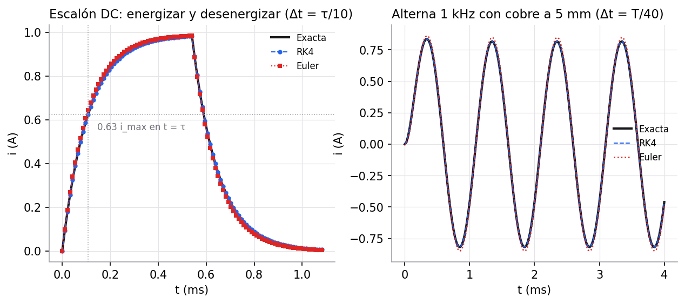
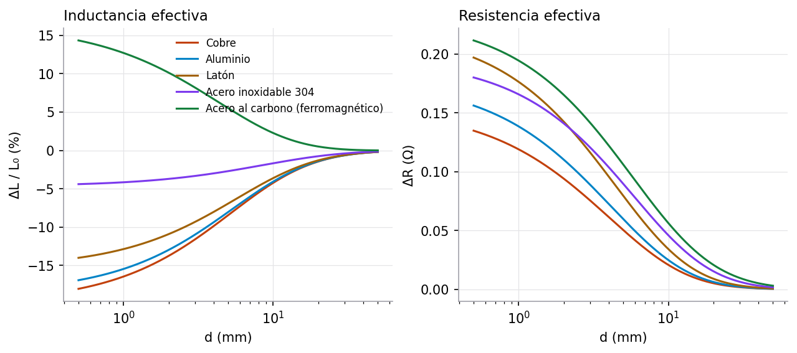
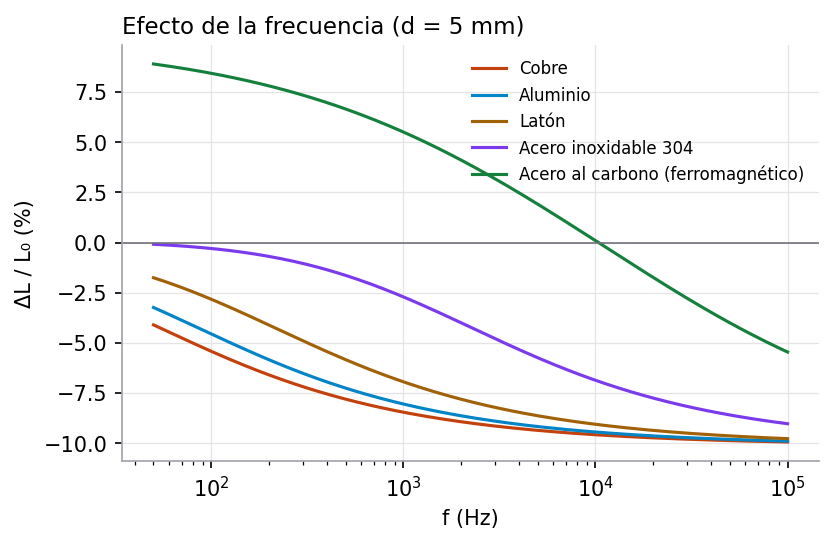

# 2. Modelamiento analítico

> Criterio de la rúbrica: **Modelamiento analítico (20 %)**, formulación y solución de ecuaciones.
> La guía pide explicar cómo se obtiene el modelo a partir de las leyes físicas, no solo sustituir
> valores. Cada resultado de esta sección se deduce paso a paso y la parte simbólica se verifica con SymPy
> en [`sensor/symbolic.py`](../sensor/symbolic.py) (pestaña **Derivación** del simulador).

Valores de referencia usados en los ejemplos (los mismos que trae por defecto el simulador):
$N = 150$, $a = 15$ mm, $l = 20$ mm, $R_0 = 5\ \Omega$, $V_0 = 5$ V, $f = 1$ kHz y pieza a $d = 5$ mm.

## 2.1 Campo magnético de la bobina idealizada

**Una espira** de radio $a$ con corriente $i$. Por Biot–Savart, sobre su eje y a una distancia $z$ de su centro,

$$B_z(z) = \frac{\mu_0\, i\, a^2}{2\,(a^2+z^2)^{3/2}} .$$

**Solenoide ideal** (largo, $l \gg a$). Se aplica Ampère, $\oint\vec B\cdot d\vec l = \mu_0 I_{enc}$, sobre un
rectángulo de longitud $l_c$ con un lado dentro del solenoide y otro fuera, donde $B\approx 0$. Solo
aporta el lado interior y el rectángulo encierra $n\,l_c$ espiras ($n = N/l$):

$$B\,l_c = \mu_0\, n\, l_c\, i \quad\Rightarrow\quad B = \frac{\mu_0 N i}{l} .$$

**Solenoide finito.** Sumando espiras sobre el eje se obtiene

$$B_z(z) = \frac{\mu_0 N i}{2l}\left[\frac{z - z_1}{\sqrt{a^2+(z-z_1)^2}} - \frac{z - z_2}{\sqrt{a^2+(z-z_2)^2}}\right],$$

con la bobina entre $z_1$ y $z_2$. Fuera del eje, el simulador suma el campo de espiras circulares
expresado con integrales elípticas completas $K$ y $E$ (función `campo_espira` en
[`sensor/physics.py`](../sensor/physics.py)).

## 2.2 Inductancia aproximada de la bobina

Igual que en clase el flujo eléctrico de un campo uniforme a través de una superficie plana es
$\Phi = \vec E\cdot\vec A$, el flujo magnético por una espira del solenoide ideal es

$$\Phi_B = \vec B\cdot\vec A = \frac{\mu_0 N i}{l}\,\pi a^2 .$$

El flujo total enlazado por las $N$ espiras es $\Lambda = N\Phi_B$, y la inductancia es la razón entre ese
flujo y la corriente (como $C = Q/\Delta V$ es la razón entre carga y potencial):

$$L = \frac{\Lambda}{i} = \frac{\mu_0 N^2 \pi a^2}{l} .$$

Una bobina de sensor es corta ($l/a = 1.33$), así que el campo no es uniforme y la fórmula ideal
sobreestima. Se usa la corrección de Wheeler (error cercano al 1 % para $l > 0.8a$):

$$L_0 = \frac{\mu_0 N^2\pi a^2}{l + 0.9a} .$$

| | Ideal $\mu_0N^2A/l$ | Wheeler |
|---|---|---|
| $L$ | 0.999 mH | **0.597 mH** |

La fórmula ideal da un 67.5 % más que la de Wheeler para esta bobina. Como $L\propto N^2$, duplicar las
espiras cuadruplica la inductancia.

## 2.3 Circuito RL: ley de mallas de Kirchhoff

Se recorre la malla en el sentido de la corriente con el acuerdo de signos de clase:

- al pasar por la fuente del polo negativo al positivo, $+\varepsilon$;
- al pasar por el resistor en el sentido de la corriente, $-\Delta V_R = -iR$;
- al pasar por la bobina en el sentido de la corriente, $-\Delta V_L = -L\,\dfrac{di}{dt}$. Este término sale
  de la ley de Faraday: la fem autoinducida es $-d\Lambda/dt = -L\,di/dt$ y se opone al cambio de corriente.

$$\sum \Delta V_i = 0 \quad\Rightarrow\quad \varepsilon - iR - L\frac{di}{dt} = 0 \tag{1}$$

### 2.3.1 Energizar la bobina (interruptor en A, fuente DC)

Con $\varepsilon = V_0$ constante, dividiendo (1) entre $L$:

$$\frac{di}{dt} = \frac{R}{L}\left(\frac{\varepsilon}{R} - i\right) = \frac{1}{\tau}\,(i_{max} - i),
\qquad i_{max} = \frac{\varepsilon}{R},\qquad \tau = \frac{L}{R} .$$

$i_{max}$ es la corriente cuando la bobina ya no se opone ($di/dt = 0$), igual que $q_{max} = \varepsilon C$
en el capacitor. La EDO es separable. Con $i(0) = 0$:

$$\int_0^t \frac{dt}{\tau} = \int_0^{i(t)} \frac{di}{i_{max} - i}
\;\Rightarrow\; \frac{t}{\tau} = -\ln\left(i_{max} - i\right)\Big|_0^{i(t)}
\;\Rightarrow\; -\frac{t}{\tau} = \ln\left|\frac{i_{max} - i(t)}{i_{max}}\right| .$$

Aplicando exponencial y despejando:

$$\boxed{\,i(t) = i_{max}\left(1 - e^{-t/\tau}\right)\,} \tag{2}$$

En $t = \tau$, $i = i_{max}(1 - e^{-1}) = 0.63\,i_{max}$. Con los valores de referencia,
$i_{max} = 1$ A y $\tau_0 = L_0/R_0 = 119.3\ \mu$s sin pieza; con cobre a 5 mm, $\tau = 108.1\ \mu$s.

### 2.3.2 Desenergizar la bobina (interruptor en B)

Retirar la fuente equivale a $\varepsilon = 0$ en (1): $L\,di/dt = -iR$. Separando variables desde
$i(t_s) = i_s$:

$$i(t) = i_s\, e^{-(t-t_s)/\tau} .$$

### 2.3.3 Analogía con el circuito RC de clase

| Circuito RC (clase) | Circuito RL (sensor) |
|---|---|
| $\varepsilon - iR - q/C = 0$ | $\varepsilon - iR - L\,di/dt = 0$ |
| variable: carga $q(t)$ | variable: corriente $i(t)$ |
| $q_{max} = \varepsilon C$ | $i_{max} = \varepsilon/R$ |
| $\tau = RC$ | $\tau = L/R$ |
| $q(t) = q_{max}(1 - e^{-t/\tau})$ | $i(t) = i_{max}(1 - e^{-t/\tau})$ |
| energía $q^2/2C$ en el campo eléctrico | energía $\tfrac12 L i^2$ en el campo magnético |
| el capacitor se opone a cambios bruscos de voltaje | la bobina se opone a cambios bruscos de corriente |

Las dos ecuaciones tienen la misma forma, por eso Euler y RK4 se validan contra la misma clase de solución
exponencial. El simulador muestra este caso con la opción **Escalón DC** (figura izquierda).

### 2.3.4 Alimentación alterna (operación real del sensor)

El sensor trabaja con $\varepsilon(t) = V_0\sin\omega t$. La solución de (1) es la suma de una parte
transitoria y una parte permanente. Para la permanente se prueba $i_{ss} = A\sin\omega t + B\cos\omega t$
(coeficientes indeterminados). Sustituyendo en (1) e igualando senos y cosenos:

$$A = \frac{V_0 R}{R^2+\omega^2L^2},\qquad B = -\frac{V_0\,\omega L}{R^2+\omega^2L^2}
\quad\Rightarrow\quad i_{ss}(t) = I_p\sin(\omega t - \varphi),$$

$$I_p = \frac{V_0}{|Z|},\qquad |Z| = \sqrt{R^2 + \omega^2L^2},\qquad \varphi = \arctan\frac{\omega L}{R} .$$

Con la condición inicial $i(0) = I_0$:

$$i(t) = \left[I_0 + I_p\sin\varphi\right]e^{-t/\tau} + I_p\sin(\omega t - \varphi). \tag{3}$$

SymPy (`dsolve`) llega a la misma expresión y verifica que el residuo al sustituirla en (1) es cero.
Sin pieza, $\omega L_0 = 3.75\ \Omega$, $|Z| = 6.25\ \Omega$ e $I_p = 0.800$ A.

**Energía y potencia**: energía magnética máxima $E_{max} = \tfrac12 L I_p^2$ y potencia media
$\langle P\rangle = \tfrac12 R I_p^2 = I_{rms}^2 R$.

## 2.4 Efecto de la pieza metálica

### Modelo simple (el que pide la propuesta)

"Inductancia constante por cada posición de detección": para cada distancia $d$ se reemplazan $L$ y $R$
por $L_{\text{eff}}(d)$ y $R_{\text{eff}}(d)$ y se usan las fórmulas anteriores. Lo que falta es calcular esos
dos valores a partir de la física.

### Cálculo de $L_{\text{eff}}$ y $R_{\text{eff}}$ (Dodd y Deeds, 1968)

Por simetría, el potencial vector solo tiene componente $A_\varphi(\rho, z)$. Separando variables, las
soluciones son de la forma $J_1(\alpha\rho)\,e^{\pm\alpha z}$ en el aire ($\nabla^2 A = 0$) y
$J_1(\alpha\rho)\,e^{\alpha_1 z}$ en el conductor ($\nabla^2 A = j\omega\mu\sigma A$), con

$$\alpha_1 = \sqrt{\alpha^2 + j\omega\mu_0\mu_r\sigma} .$$

Al imponer las condiciones de frontera de la sección 1.5 en $z = 0$ aparece el coeficiente de reflexión

$$\Gamma(\alpha) = \frac{\mu_r\alpha - \alpha_1}{\mu_r\alpha + \alpha_1},$$

y al sumar sobre las espiras de la bobina, el factor geométrico

$$F(\alpha) = \frac{e^{-\alpha d} - e^{-\alpha(d+l)}}{\alpha l} .$$

El cambio de impedancia que produce la pieza es

$$\Delta Z = j\omega\pi\mu_0 a^2 N^2 \int_0^\infty J_1^2(\alpha a)\,\Gamma(\alpha)\,F^2(\alpha)\,d\alpha,$$

y de él salen los parámetros efectivos:

$$L_{\text{eff}} = L_0 + \frac{\operatorname{Im}\Delta Z}{\omega},\qquad R_{\text{eff}} = R_0 + \operatorname{Re}\Delta Z .$$

La integral se evalúa numéricamente (regla del trapecio en una malla logarítmica de 6000 puntos, función
`delta_Z`). Para una sola espira y un conductor perfecto se reduce a $\Delta L = -M$, donde $M$ es la
inductancia mutua entre la espira y su imagen a distancia $2d$: es el **método de las imágenes**.

### Resultados ($d = 5$ mm, $f = 1$ kHz)

| Material | $\sigma$ (S/m) | $\mu_r$ | $\delta$ (mm) | $\Delta L/L_0$ | $\Delta R$ (Ω) |
|---|---|---|---|---|---|
| Cobre | $5.96\times10^{7}$ | 1 | 2.06 | −8.45 % | +0.050 |
| Aluminio | $3.77\times10^{7}$ | 1 | 2.59 | −8.05 % | +0.060 |
| Latón | $1.5\times10^{7}$ | 1 | 4.11 | −6.94 % | +0.080 |
| Acero inoxidable 304 | $1.45\times10^{6}$ | 1.02 | 13.1 | −2.71 % | +0.090 |
| Acero al carbono | $6.0\times10^{6}$ | 100 | 0.65 | **+5.51 %** | +0.106 |

El acero al carbono cambia de signo con la frecuencia: $\Delta L/L_0$ = +8.4 % a 100 Hz, +5.5 % a 1 kHz,
+0.1 % a 10 kHz y −4.0 % a 50 kHz. A baja frecuencia domina la magnetización; a alta frecuencia $\delta$ es tan
pequeña que domina el apantallamiento por corrientes de Foucault.

## 2.5 Pieza en movimiento: inductancia variable

Si la pieza se mueve, $L$ depende del tiempo. La ley de Faraday se aplica al flujo enlazado
$\Lambda = L(t)\,i$:

$$\varepsilon - iR - \frac{d}{dt}\big[L(t)\,i\big] = 0
\quad\Rightarrow\quad \frac{di}{dt} = \frac{\varepsilon(t) - \left[R(t) + \dot L(t)\right] i}{L(t)} .$$

El término $\dot L\, i$ actúa como una resistencia adicional. Para una pieza que se mueve despacio frente al
período de la fuente es pequeño, y la amplitud sigue la curva cuasi-estática $V_0/|Z(d(t))|$. Esta EDO no tiene
solución cerrada, así que se resuelve solo numéricamente (pestaña **Paso del objeto**).

## 2.6 Señal de detección y sensibilidad

El sensor compara la amplitud con pieza, $I_p$, con la amplitud sin pieza, $I_{p,0}$:

$$s = \frac{|I_p - I_{p,0}|}{I_{p,0}} \ \ge\ \text{umbral}\quad\Rightarrow\quad \text{detectado}.$$

Derivando $I_p = V_0/\sqrt{R^2+\omega^2L^2}$:

$$\frac{\partial I_p}{\partial L} = -\frac{V_0\,\omega^2 L}{(R^2+\omega^2L^2)^{3/2}},\qquad
\frac{\partial I_p}{\partial R} = -\frac{V_0\,R}{(R^2+\omega^2L^2)^{3/2}} .$$

Las dos derivadas son negativas. En un conductor no magnético, $L$ baja (lo que sube $I_p$) y $R$ sube (lo que
baja $I_p$): los efectos compiten. Con el acero inoxidable casi se cancelan y la señal es muy débil
(0.20 %). Ese resultado se discute en la [validación](06-validacion-e-impacto.md).

## 2.7 Análisis dimensional

| Expresión | Unidades | Comprobación |
|---|---|---|
| $L = \mu_0 N^2 A/l$ | $\dfrac{\text{H}}{\text{m}}\cdot\dfrac{\text{m}^2}{\text{m}} = \text{H}$ | ✓ |
| $\tau = L/R$ | $\dfrac{\text{V·s/A}}{\text{V/A}} = \text{s}$ | ✓ |
| $L\,di/dt$ | $\text{H}\cdot\text{A/s} = \text{V}$ | igual que $\varepsilon$ e $iR$ ✓ |
| $\omega L$ | $\text{s}^{-1}\cdot\text{H} = \Omega$ | se suma con $R$ en $|Z|$ ✓ |
| $\delta = \sqrt{2/(\omega\mu\sigma)}$ | $\sqrt{\dfrac{1}{\text{s}^{-1}\cdot\text{H/m}\cdot\text{S/m}}} = \text{m}$ | ✓ |
| $\alpha^2$ y $\omega\mu\sigma$ en $\alpha_1$ | $\text{m}^{-2}$ ambos | se pueden sumar ✓ |
| $\Delta Z = j\omega\mu_0 a^2N^2\int\ldots d\alpha$ | $\text{s}^{-1}\cdot\text{H/m}\cdot\text{m}^2\cdot\text{m}^{-1} = \Omega$ | ✓ |
| $\tfrac12 L i^2$ | $\text{H}\cdot\text{A}^2 = \text{J}$ | ✓ |

## 2.8 Interpretación física

- La pieza **conductora no magnética** expulsa flujo (Lenz). $L$ baja y $R$ sube, más cuanto más cerca está y
  cuanto mejor conduce.
- El efecto decae en distancias del orden del **radio de la bobina**: a $d = a$ ya es pequeño. Por eso los
  sensores comerciales tienen alcances de una fracción de su diámetro.
- La **frecuencia** controla $\delta$. A más frecuencia, corrientes más superficiales y respuesta más
  parecida entre metales no ferrosos; los ferromagnéticos pasan de aumentar a disminuir $L$.
- En el escalón DC la bobina se comporta como el capacitor de clase pero con la corriente como variable: crece
  hasta el 63 % en $\tau$, y la pieza, al bajar $L$, acorta $\tau$.
