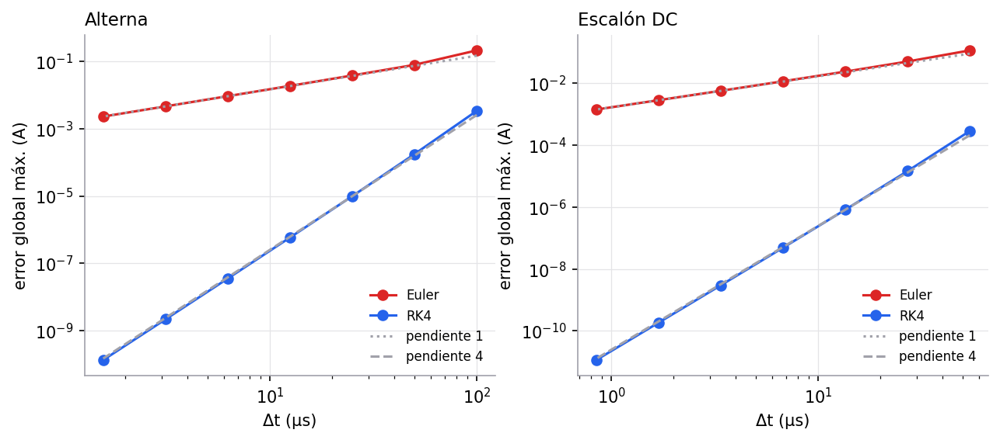
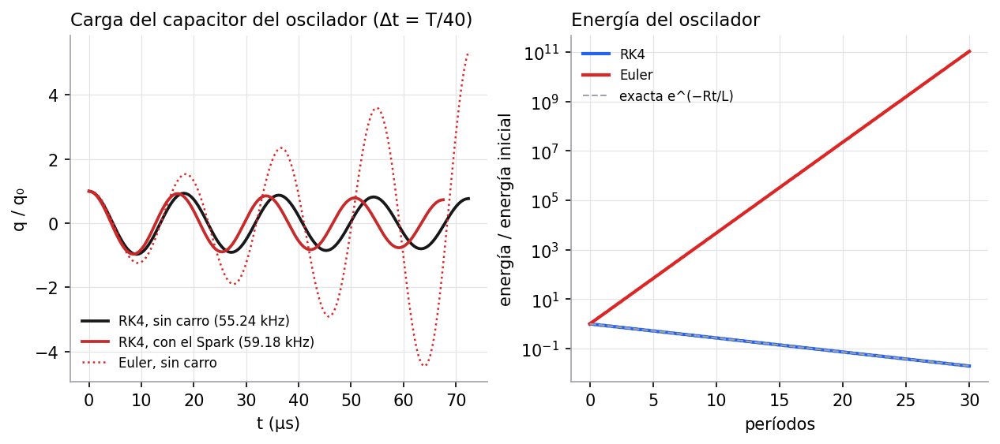

# 3. Métodos numéricos

> Criterio de la rúbrica: **Métodos numéricos (20 %)**, implementación y comparación de Euler y RK4.
> Indicadores de la guía: error absoluto, error relativo, convergencia, influencia del paso temporal,
> consistencia dimensional y coherencia con los principios físicos.

Código: [`sensor/numerics.py`](../sensor/numerics.py). Pruebas: [`tests/test_modelo.py`](../tests/test_modelo.py).
Pestañas del simulador: **Respuesta temporal**, **Paso del objeto** y **Validación**.

## 3.1 Problema de valor inicial

Toda la dinámica del sensor se escribe como una EDO de primer orden $\;i' = f(t, i)$, $\;i(0) = I_0$:

| Caso | $f(t, i)$ | Solución de referencia |
|---|---|---|
| Escalón DC | $\dfrac{V_0 - Ri}{L}$, y $-\dfrac{Ri}{L}$ al desenergizar | exacta, ec. (2) |
| Alterna | $\dfrac{V_0\sin\omega t - Ri}{L}$ | exacta, ec. (3) |
| Pieza en movimiento | $\dfrac{V_0\sin\omega t - \left[R(t)+\dot L(t)\right] i}{L(t)}$ | `solve_ivp` con `rtol = 1e-8` |
| Oscilador LC del detector (carro) | sistema $(q, i)$: $\dot q = i$, $\dot i = -(Ri + q/C)/L$ | exacta (sección 2.10.3) |

## 3.2 Métodos programados a mano

Con paso $h = \Delta t$ y $t_k = t_0 + kh$:

**Euler explícito** (se toma la pendiente al inicio del intervalo):

$$i_{k+1} = i_k + h\, f(t_k, i_k)$$

**Runge–Kutta clásico de cuarto orden**: se promedian cuatro pendientes, una al inicio, dos en el punto medio
y una al final del intervalo.

$$\begin{aligned}
k_1 &= f(t_k,\ i_k) & k_2 &= f\!\left(t_k + \tfrac h2,\ i_k + \tfrac h2 k_1\right)\\
k_3 &= f\!\left(t_k + \tfrac h2,\ i_k + \tfrac h2 k_2\right) & k_4 &= f(t_k + h,\ i_k + h k_3)\\
i_{k+1} &= i_k + \tfrac h6\,(k_1 + 2k_2 + 2k_3 + k_4)
\end{aligned}$$

Las funciones `euler` y `rk4` son genéricas (reciben cualquier `f(t, y)`) y no usan ninguna librería de
integración. `scipy.integrate.solve_ivp` (RK45 adaptativo) se usa **solo para contrastar**, como permite la guía.

Dos detalles de implementación:

- **Discontinuidad del interruptor (DC).** Al pasar de A a B la fem salta de $V_0$ a $0$. Si ese salto cae
  dentro de un paso, RK4 evaluaría $k_4$ con la fem equivocada y perdería su orden. Por eso se integra por
  tramos: primero el energizado hasta $t_s$ y luego el desenergizado desde $t_s$.
- **Inductancia variable.** $L(t)$, $R(t)$ y $\dot L(t)$ se precalculan en la malla de medio paso
  $t_k,\ t_k + h/2,\ t_k + h$, que son exactamente los instantes donde RK4 evalúa $f$.

### 3.2.1 El primer paso, hecho a mano

Para ver qué hace cada método, se calcula el primer paso del energizado. Cobre a 5 mm: $L = 0.5462$ mH,
$R = 5.0503\ \Omega$, $V_0 = 5$ V, $\tau = 108.1\ \mu$s. Paso $h = \tau/10 = 10.81\ \mu$s, con $i_0 = 0$.

La pendiente es $f(t, i) = (V_0 - Ri)/L$, en A/s.

| Cálculo | Valor |
|---|---|
| $k_1 = f(0,\ 0)$ | 9154.8 A/s |
| $k_2 = f\!\left(\tfrac h2,\ \tfrac h2 k_1\right)$ | 8697.1 A/s |
| $k_3 = f\!\left(\tfrac h2,\ \tfrac h2 k_2\right)$ | 8720.0 A/s |
| $k_4 = f(h,\ h k_3)$ | 8282.8 A/s |
| **Euler**: $i_1 = h\,k_1$ | 0.099004 A |
| **RK4**: $i_1 = \tfrac h6(k_1 + 2k_2 + 2k_3 + k_4)$ | 0.094214 A |
| **Exacta**: $i_{max}(1 - e^{-0.1})$ | 0.094214 A |

Euler usa la pendiente inicial, que es la más alta porque la corriente todavía es cero, y por eso **se pasa**
un 5 %. RK4 "se da cuenta" de que la pendiente disminuye al avanzar ($k_4 < k_1$) y coincide con la solución exacta
en los seis decimales mostrados.

## 3.3 Definición de los errores

$$e_{abs} = \max_k\,\big|i_k - i(t_k)\big|,\qquad
e_{rel} = \frac{e_{abs}}{\max_k |i(t_k)|}\times 100\ \% .$$

El error relativo se normaliza con la amplitud máxima. El cociente punto a punto
$|i_k - i(t_k)|/|i(t_k)|$ no sirve aquí porque la corriente alterna pasa por cero y el cociente diverge.

**Orden observado** entre dos pasos consecutivos (cada fila usa la mitad del paso anterior):

$$p = \frac{\ln(e_k/e_{k+1})}{\ln(h_k/h_{k+1})} .$$

## 3.4 Resultados: convergencia y error

Bobina de referencia con cobre a 5 mm ($L = 0.5462$ mH, $R = 5.0503\ \Omega$, $\tau = 108.1\ \mu$s), $V_0 = 5$ V.

### Alterna, 1 kHz, 3 ciclos

| Pasos/ciclo | $\Delta t$ (µs) | Euler $e_{abs}$ (A) | Euler $e_{rel}$ | RK4 $e_{abs}$ (A) | RK4 $e_{rel}$ | $p$ Euler | $p$ RK4 |
|---|---|---|---|---|---|---|---|
| 10 | 100.0 | 0.208 | 25.6 % | 3.34e−3 | 0.41 % | – | – |
| 20 | 50.0 | 0.078 | 9.27 % | 1.75e−4 | 0.021 % | 1.43 | 4.26 |
| 40 | 25.0 | 0.038 | 4.48 % | 9.85e−6 | 1.2e−3 % | 1.05 | 4.15 |
| 80 | 12.5 | 0.018 | 2.20 % | 5.84e−7 | 7.0e−5 % | 1.02 | 4.08 |
| 160 | 6.25 | 9.14e−3 | 1.09 % | 3.55e−8 | 4.2e−6 % | 1.01 | 4.04 |
| 320 | 3.125 | 4.55e−3 | 0.54 % | 2.19e−9 | 2.6e−7 % | 1.01 | 4.02 |

### Escalón DC, duración $6\tau$

| Pasos/τ | $\Delta t$ (µs) | Euler $e_{abs}$ (A) | Euler $e_{rel}$ | RK4 $e_{abs}$ (A) | RK4 $e_{rel}$ | $p$ Euler | $p$ RK4 |
|---|---|---|---|---|---|---|---|
| 2 | 54.07 | 0.117 | 12.4 % | 2.89e−4 | 0.031 % | – | – |
| 4 | 27.04 | 0.051 | 5.42 % | 1.46e−5 | 1.6e−3 % | 1.20 | 4.30 |
| 8 | 13.52 | 0.024 | 2.55 % | 8.23e−7 | 8.7e−5 % | 1.09 | 4.15 |
| 16 | 6.76 | 0.012 | 1.24 % | 4.88e−8 | 5.2e−6 % | 1.04 | 4.08 |
| 32 | 3.38 | 5.77e−3 | 0.61 % | 2.97e−9 | 3.2e−7 % | 1.02 | 4.04 |
| 64 | 1.69 | 2.86e−3 | 0.30 % | 1.83e−10 | 1.9e−8 % | 1.01 | 4.02 |

**Lectura de las tablas**

- Al dividir $\Delta t$ entre 2, el error de Euler se divide entre 2 ($p\to 1$) y el de RK4 entre 16 ($p\to 4$).
  Coinciden con los órdenes teóricos $\mathcal O(h)$ y $\mathcal O(h^4)$.
- Para una precisión del 1 %, Euler necesita unos 160 pasos por ciclo; RK4 la alcanza con 10.
- RK4 hace 4 evaluaciones de $f$ por paso y Euler 1. Aun así, RK4 con 20 pasos (80 evaluaciones) es unas 26 veces
  más preciso que Euler con 320 pasos (320 evaluaciones).
- Con pasos muy pequeños el error de RK4 baja hasta el redondeo de máquina ($\sim10^{-15}$ A) y el orden deja de
  poder medirse. El simulador lo indica.

### 3.4.1 Validación con el ejercicio de clase

Las mismas funciones resuelven la carga del capacitor del apunte ($R = 60$ kΩ, $C = 200$ µF, $\varepsilon = 9$ V,
$\tau = 12$ s, duración $5\tau$):

| Pasos/τ | $\Delta t$ | Euler $e_{abs}$ (C) | RK4 $e_{abs}$ (C) |
|---|---|---|---|
| 2 | 6 s | 2.1e−4 (12 % de $q_{max}$) | 5.2e−7 |
| 10 | 1.2 s | 3.5e−5 (1.9 %) | 6.0e−10 |
| 50 | 0.24 s | 6.7e−6 (0.37 %) | 9.0e−13 |

El comportamiento es el mismo que en la bobina, aunque las escalas son muy distintas (segundos en vez de
microsegundos). Lo que controla el error es $\Delta t/\tau$, no el valor absoluto del paso.

### 3.4.2 Costo computacional

| Tarea | Tiempo |
|---|---|
| Resolver 6 ciclos con Euler, RK4, SciPy y la solución exacta (240 pasos) | 33 ms |
| Integral de Dodd–Deeds para 260 distancias | 25 ms |

Todo el cálculo de una pantalla del simulador toma una fracción de segundo. Por eso los parámetros se pueden
mover en vivo.

## 3.5 Influencia del paso: estabilidad

En la EDO homogénea $i' = -i/\tau$, un paso de Euler multiplica la corriente por $(1 - h/\tau)$. Para que el
error no crezca hace falta

$$\left|1 - \frac{h}{\tau}\right| < 1 \quad\Rightarrow\quad h < 2\tau .$$

RK4 multiplica por $1 - x + x^2/2 - x^3/6 + x^4/24$ con $x = h/\tau$, que es estable para $h < 2.785\,\tau$.
Con $\tau = 108\ \mu$s el límite de Euler es $\Delta t < 216\ \mu$s. A 100 Hz y 40 pasos por ciclo,
$\Delta t = 250\ \mu$s: Euler diverge y el simulador lo avisa. Lo que hay que comparar es $\Delta t/\tau$, no
$\Delta t$ solo.

## 3.6 Consistencia dimensional y coherencia física

- $h\,f(t,i)$ tiene unidades de s·A/s = A, igual que $i$, así que cada actualización es dimensionalmente
  correcta. El parámetro que controla la estabilidad, $h/\tau$, es adimensional.
- **Coherencia física** verificada en [`tests/test_modelo.py`](../tests/test_modelo.py):
  - en $t = \tau$ la corriente es el 63 % de $i_{max}$;
  - al desenergizar, la corriente decae a cero;
  - un conductor no magnético reduce $L$ y aumenta $R$; un ferromagnético a baja frecuencia aumenta $L$;
  - el efecto disminuye con la distancia;
  - un conductor perfecto da $\Gamma \to -1$;
  - el campo en el centro de una espira es $\mu_0 I/2a$.
- La energía disipada es siempre positiva ($\Delta R > 0$ para todo material), como exige la segunda ley.

### 3.6.1 Conservación de la energía en la solución numérica

Una prueba más exigente que comparar curvas es verificar que la solución numérica conserva la energía
(sección 2.3.6). Integrando la corriente de RK4 durante el energizado:

$$\int\varepsilon\, i\,dt = 2.1449\ \text{mJ},\qquad \int i^2R\,dt + \tfrac12Li^2 = 1.8809 + 0.2641\ \text{mJ}.$$

La diferencia relativa es $5\times10^{-7}$ y está fijada como prueba automática
(`test_balance_de_energia_al_energizar`).

## 3.7 Caso sin solución analítica: pieza en movimiento

Con $L(t)$ variable no hay fórmula cerrada. La referencia es `solve_ivp` con tolerancia $10^{-8}$. Con
40 pasos por ciclo, RK4 difiere de ella unos $10^{-5}$ A y Euler unos $4\times10^{-2}$ A, la misma relación que
en los casos con solución exacta. La envolvente de la corriente coincide con la curva cuasi-estática
$V_0/|Z(d(t))|$, lo que confirma que $\dot L\,i$ es despreciable a velocidades de banda normales.

## 3.8 Extensiones no implementadas

La guía aclara que Euler y RK4 bastan para modelos de EDO. Resolver directamente las ecuaciones de Maxwell en
3D (geometría finita de la pieza, núcleo de ferrita) requeriría diferencias finitas o elementos finitos. Aquí
esa parte se sustituye por la solución semianalítica de Dodd–Deeds, que reduce el problema a una integral en
una dimensión.

## 3.9 El oscilador LC del detector

El caso del carro agrega un problema numérico distinto: el oscilador LC del detector es una EDO de **segundo
orden** (sección 2.10.3),

$$L\ddot q + R\dot q + \frac{q}{C} = 0 .$$

### Como sistema de primer orden

Euler y RK4 se aplican a sistemas escribiendo el estado como un vector $\mathbf y = (q, i)$:

$$\frac{d}{dt}\begin{pmatrix} q \\ i \end{pmatrix} = \begin{pmatrix} i \\ -\dfrac{Ri + q/C}{L} \end{pmatrix}.$$

Las funciones `euler_sistema` y `rk4_sistema` de [`sensor/numerics.py`](../sensor/numerics.py) son las mismas fórmulas
de la sección 3.2 con $y$ vectorial. El oscilador está en `oscilador()` de [`sensor/vehiculo.py`](../sensor/vehiculo.py):
arranca con el capacitor cargado, integra 30 períodos y mide la frecuencia contando los cruces por cero de $q(t)$,
interpolados entre pasos. Es lo mismo que hace un detector real.

### Resultados (espira sin carro, 30 períodos)

| Pasos por período | Error en $f$, RK4 | Error en $f$, Euler | Energía final / inicial, RK4 | Energía final / inicial, Euler |
|---|---|---|---|---|
| 10 | −1.1e−3 | −1.0e−1 | 0.016 | 1.3e+42 |
| 20 | −8.1e−5 | −2.8e−2 | 0.0196 | 9.5e+22 |
| 40 | −5.1e−6 | −6.5e−3 | 0.0197 | 1.1e+11 |
| 80 | −3.2e−7 | −1.2e−3 | 0.0197 | 5.2e+4 |
| 160 | −2.0e−8 | −1.1e−4 | 0.0197 | 32 |

La energía exacta al final es $e^{-Rt/L} = 0.0197$: el oscilador pierde el 98 % de su energía en 30 períodos por la
resistencia de la espira ($Q = 48$).

**Lectura de la tabla:**

- **RK4** converge con orden 4 también aquí: al duplicar los pasos, el error de frecuencia baja unas 16 veces
  (8.1e−5 → 5.1e−6 → 3.2e−7). Desde 20 pasos por período reproduce la pérdida de energía exacta.
- **Euler explícito es inestable en un oscilador.** Con cualquier paso la energía crece, aunque el circuito tenga
  resistencia: con 40 pasos por período se multiplica por $10^{11}$ en 30 períodos, y la oscilación "explota".

### Por qué Euler explota

Sin resistencia, el oscilador es $\dot{\mathbf y} = A\mathbf y$, con valores propios $\pm j\omega$. Un paso de Euler
multiplica cada modo por $1 + j\omega h$, cuyo módulo es

$$\lvert 1 + j\omega h\rvert = \sqrt{1 + (\omega h)^2} > 1\quad\text{para todo } h > 0 .$$

La energía, que va como el cuadrado de la amplitud, crece en un factor $1 + (\omega h)^2$ por paso. Con 40 pasos por
período, $\omega h = 2\pi/40$ y el factor por período es $(1 + 0.0247)^{40} = 2.65$. La resistencia quita un factor
$e^{-2\pi/Q} = 0.877$ por período, de modo que la energía neta crece $2.32$ veces por período, y en 30 períodos
$2.32^{30} \approx 10^{11}$, el valor de la tabla.

En el circuito RL de las secciones anteriores Euler era estable si $\Delta t < 2\tau$. Aquí no hay paso que lo haga
estable. La diferencia está en los valores propios: el RL tiene uno real negativo ($-1/\tau$) y el oscilador los
tiene imaginarios. RK4 sí es estable para $\omega h < 2.83$, es decir, con más de unos 2.2 pasos por período, y su
pequeña disipación numérica es despreciable con 20 pasos o más.

### Validación de la fórmula exacta del cambio de frecuencia

Se simuló el oscilador con la inductancia y la resistencia que deja el Spark encima ($\Delta L/L_0 = -12.87$ %,
$\Delta R = +0.064\ \Omega$). El cambio de frecuencia medido en la simulación es **+7.130 %** con cualquier paso de RK4.
La fórmula exacta $(1 + \Delta L/L_0)^{-1/2} - 1$ da +7.13 %, y la aproximación lineal $-\tfrac12\Delta L/L_0$ da
+6.44 %. **La simulación decidió cuál fórmula usar**, y todo el proyecto (simulador, escena 3D, figura de Anatomy y
documentos) se corrigió a la exacta.

Este caso tiene solución analítica (sección 2.10.3), así que también sirve para validar los métodos. Queda fijado
como prueba automática en `test_oscilador_lc_del_detector`: frecuencia de RK4 con error menor que $10^{-4}$, caída
de energía igual a $e^{-Rt/L}$, $\Delta f/f$ igual a la fórmula exacta y crecimiento de la energía con Euler.

Costo: 30 períodos con 40 pasos por período (1 200 pasos de RK4) toman unos 6 ms.
