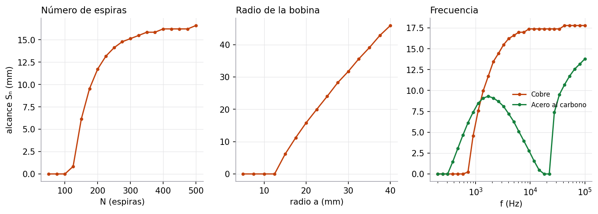

# 5. Simulación computacional

> Criterio de la rúbrica: **Simulación (15 %)**, interactividad y representación del sistema.

## 5.1 Parámetros modificables (barra lateral)

| Grupo | Parámetro | Rango |
|---|---|---|
| Bobina | Número de espiras $N$ | 10 – 500 |
| | Radio $a$, longitud $l$ | 5 – 50 mm, 5 – 100 mm |
| | Resistencia del devanado $R_0$ | 0.5 – 100 Ω |
| Fuente | Alimentación | alterna $V_0\sin\omega t$ o escalón DC |
| | Frecuencia $f$ | 100 Hz – 50 kHz |
| | Amplitud $V_0$, corriente inicial $I(0)$ | 1 – 24 V, −2 – 2 A |
| Objeto | Material | aire, cobre, aluminio, latón, acero inoxidable 304, acero al carbono |
| | Distancia $d$ | 0.5 – 40 mm |
| | Umbral de activación, histéresis | 0.2 – 20 %, 0 – 30 % |
| Numérico | Pasos por ciclo, duración (alterna) | 8 – 400, 1 – 20 ciclos |
| | Pasos por τ, duración (escalón DC) | 2 – 200, 2 – 20 τ |

El selector de la parte superior cambia entre tema claro y oscuro.

## 5.2 Pestañas

| Pestaña | Qué muestra |
|---|---|
| **Modelo** | $\Delta L/L_0$ y $\Delta R$ frente a la distancia para todos los materiales, curva de detección con el umbral y la distancia de conmutación $S_n$, efecto de la frecuencia, ecuaciones del modelo |
| **Respuesta temporal** | $i(t)$ exacta, RK4, Euler y SciPy. En alterna, la zona muerta del umbral; en DC, $i_{max}$, el 63 % en $t=\tau$ y el cambio del interruptor. Energía y potencia |
| **Paso del objeto** | La pieza se acerca y se aleja: $d(t)$, $L(t)$, $i(t)$, envolvente demodulada, umbrales ON/OFF con histéresis y salida digital del sensor |
| **Campo** | Líneas de $\vec B$ y mapa de $\lvert\vec B\rvert$ con la pieza y $\delta$; perfil $B_z$ sobre el eje con y sin pieza |
| **Validación** | Error frente a $\Delta t$ en log-log con pendientes 1 y 4, orden observado, límites de estabilidad, tabla descargable en CSV, error en el tiempo |
| **Derivación** | Deducción simbólica con SymPy y sensibilidades evaluadas con los parámetros actuales |
| **Análisis** | Interpretación física del caso, comparación de materiales, rendimiento en una línea de producción y limitaciones frente a FEM |

## 5.3 Cumplimiento de las características mínimas de la guía (3.1)

| Característica mínima | Dónde está |
|---|---|
| Parámetros físicos modificables | Barra lateral: bobina, fuente y objeto |
| Condiciones iniciales | $I(0)$ en la barra lateral |
| Visualización de las variables electromagnéticas | $L_{\text{eff}}$, $R_{\text{eff}}$, $\lvert Z\rvert$, $\varphi$, $\delta$, $\Gamma$ en la cabecera y en Modelo |
| Representación de campos | Pestaña Campo: líneas de $\vec B$, $\lvert\vec B\rvert$ y $B_z(z)$ |
| Gráficas temporales | Respuesta temporal y Paso del objeto |
| Comparación de escenarios | Cinco materiales superpuestos, con y sin pieza, AC frente a DC, Euler frente a RK4 |
| Cálculo de energía, potencia o eficiencia | Energía $\tfrac12LI^2$, potencia total y disipada en la pieza, piezas por minuto |
| Interpretación de resultados | Texto generado según el caso en la pestaña Análisis |
| Señal de salida y umbral (propuesta) | Indicador de estado en la cabecera, curva de detección y salida digital |

## 5.4 Guion para mostrarlo en vivo

1. Con cobre a 5 mm, mostrar el indicador **Detectado** y $\Delta L = -8.45$ %.
2. Alejar la pieza con el control de distancia hasta que el indicador pase a **Sin detección**, cerca de
   $S_n = 6.1$ mm.
3. Cambiar a acero al carbono: $\Delta L$ se vuelve positiva. Subir la frecuencia a 50 kHz y ver que vuelve
   a ser negativa.
4. **Paso del objeto**: la salida se activa y se desactiva en distancias distintas por la histéresis.
5. **Validación**: bajar los pasos por ciclo y ver cómo crece el error de Euler. Mostrar las pendientes 1 y 4.
6. Cambiar a **Escalón DC** y relacionarlo con el circuito RC de clase (63 % en $t = \tau$).

## 5.5 Estudio de escenarios

La guía pide comparar escenarios. Con el simulador se barrió un parámetro a la vez, con el resto en los valores de
referencia, para ver cómo cambia el **alcance** $S_n$ (distancia máxima a la que la señal supera el 2 %).

### Número de espiras

| $N$ | $L_0$ (mH) | $\tau_0$ (µs) | Señal a 5 mm | $S_n$ |
|---|---|---|---|---|
| 50 | 0.066 | 13 | 0.06 % | no detecta |
| 100 | 0.27 | 53 | 0.41 % | no detecta |
| 150 | 0.60 | 119 | 2.35 % | 6.1 mm |
| 300 | 2.39 | 477 | 7.68 % | 15.1 mm |
| 500 | 6.63 | 1326 | 8.87 % | 16.6 mm |

Más espiras dan más alcance, pero con rendimiento decreciente. Cuando $\omega L \gg R$, la señal se acerca al
cambio relativo de $L$ (8.45 %) y ya no puede crecer más. A cambio, $\tau$ aumenta con $N^2$ y el sensor se vuelve
más lento.

### Radio de la bobina

| $a$ (mm) | $\Delta L/L_0$ a 5 mm | $S_n$ | $S_n/a$ |
|---|---|---|---|
| 10 | −4.5 % | no detecta | – |
| 15 | −8.5 % | 6.1 mm | 0.41 |
| 25 | −16.1 % | 24.0 mm | 0.96 |
| 40 | −25.2 % | 45.9 mm | 1.15 |

El radio es el parámetro que más influye en el alcance, como predice el campo dipolar
([sección 1.10](01-fundamentacion-fisica.md#110-la-bobina-vista-de-lejos-un-dipolo-magnético)). Los sensores
comerciales grandes (M30) alcanzan más que los pequeños (M8) por la misma razón.

### Frecuencia

| $f$ | Cobre $\Delta L/L_0$ | Cobre $S_n$ | Acero $\Delta L/L_0$ | Acero $S_n$ |
|---|---|---|---|---|
| 200 Hz | −6.6 % | no detecta | +7.8 % | no detecta |
| 1 kHz | −8.5 % | 6.1 mm | +5.5 % | 7.9 mm |
| 5 kHz | −9.4 % | 16.6 mm | +1.9 % | 6.1 mm |
| 20 kHz | −9.7 % | 17.4 mm | −1.7 % | **no detecta** |
| 50 kHz | −9.9 % | 17.8 mm | −4.0 % | 11.5 mm |

El resultado más llamativo es la **frecuencia ciega** del acero, cerca de 20 kHz. Ahí la magnetización (que sube
$L$) y las corrientes de Foucault (que la bajan) se cancelan, y el sensor no ve la pieza aunque esté muy cerca.
A frecuencias bajas (por debajo de unos 400 Hz para el acero y 800 Hz para el cobre) no se detecta ningún material,
porque $\omega L$ es pequeño frente a $R$ (factor de calidad bajo).

### Resistencia del devanado

| $R_0$ | $Q$ | Señal a 5 mm | $S_n$ |
|---|---|---|---|
| 1 Ω | 3.7 | 8.1 % | 15.8 mm |
| 5 Ω | 0.75 | 2.3 % | 6.1 mm |
| 10 Ω | 0.37 | 0.56 % | no detecta |

Un alambre más grueso (menor $R_0$) mejora la sensibilidad sin cambiar la geometría.

## 5.6 Cómo reproducir un escenario

1. Fijar los parámetros en la barra lateral.
2. Pestaña **Modelo**: leer $S_n$ en la leyenda de la curva de detección.
3. Pestaña **Análisis**: la tabla de materiales da $\Delta L$, $\Delta R$, la señal y $S_n$ de los cinco materiales.
4. Para el informe, `scripts/generar_figuras.py` regenera las gráficas de esta sección.
