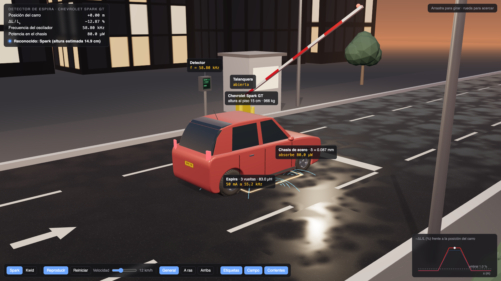
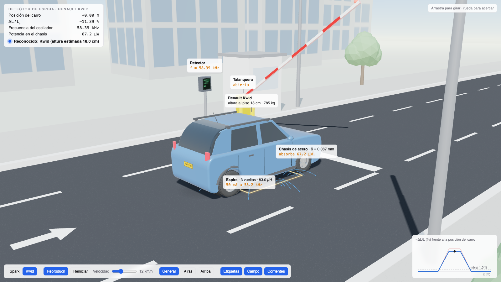
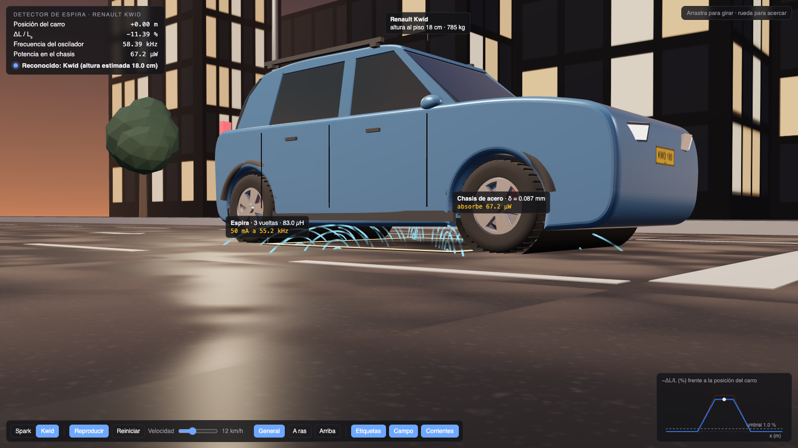
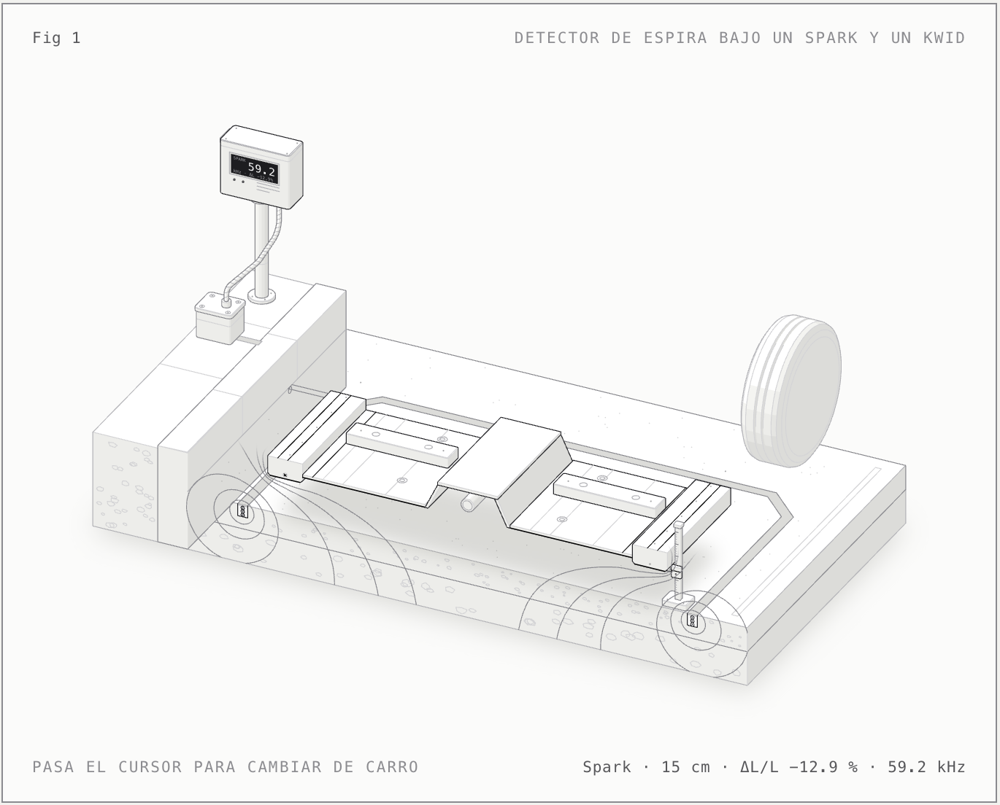

# 5. Simulación computacional

> Criterio de la rúbrica: **Simulación (15 %)**, interactividad y representación del sistema.

## 5.1 Parámetros modificables (barra lateral)

| Grupo | Parámetro | Rango |
|---|---|---|
| Bobina | Número de espiras $N$ | 10 – 500 |
| | Radio $a$, longitud $l$ | 5 – 50 mm, 5 – 100 mm |
| | Resistencia del devanado $R_0$ | 0.5 – 100 Ω |
| Fuente | Alimentación | alterna $V_0\sin\omega t$ o escalón DC |
| | Frecuencia $f$ | 100 Hz – 50 kHz |
| | Amplitud $V_0$, corriente inicial $I(0)$ | 1 – 24 V, −2 – 2 A |
| Objeto | Material | aire, cobre, aluminio, latón, acero inoxidable 304, acero al carbono |
| | Distancia $d$ | 0.5 – 40 mm |
| | Umbral de activación, histéresis | 0.2 – 20 %, 0 – 30 % |
| Numérico | Pasos por ciclo, duración (alterna) | 8 – 400, 1 – 20 ciclos |
| | Pasos por τ, duración (escalón DC) | 2 – 200, 2 – 20 τ |

El selector de la parte superior cambia entre tema claro y oscuro.

**Controles de la pestaña Caso: vehículo** (caso principal):

| Parámetro | Rango |
|---|---|
| Carro | Chevrolet Spark GT o Renault Kwid |
| Velocidad al cruzar la espira | 3 – 40 km/h |
| Lado de la espira cuadrada | 0.8 – 2.5 m |
| Vueltas de la espira | 1 – 6 |
| Profundidad de la espira en el pavimento | 2 – 10 cm |
| Sensibilidad del detector $\lvert\Delta L/L\rvert$ | 0.1 – 5 % |
| Pasos por período del oscilador LC | 10 – 160 |

Dentro de la escena 3D: carro, reproducir o pausar, velocidad, tres cámaras y mostrar u ocultar etiquetas, campo y
corrientes.

## 5.1.1 La escena 3D del caso del carro

| Atardecer (tema oscuro) | Día (tema claro) |
|---|---|
|  |  |

Los carros se construyen por código con las medidas reales de cada modelo (largo, ancho, alto, altura al piso y
distancia entre ejes); no son modelos 3D descargados. Las líneas de campo y todas las lecturas salen del modelo de
Python. Para capturas fijas se puede abrir la escena con `?x=0&cam=ras&lab=0` (posición del carro, cámara y
etiquetas).

**Qué pasa en la escena:** el carro llega, frena y se detiene sobre la espira. La inductancia baja, el oscilador
sube de 55.24 a 59.18 kHz (Spark) o a 58.69 kHz (Kwid), la pantalla del detector muestra el modelo reconocido y la
talanquera se levanta. Las etiquetas muestran la inductancia de la espira, la potencia que absorbe el chasis
(80 µW el Spark, 67 µW el Kwid) y la profundidad de penetración en el acero (0.087 mm).

## 5.1.2 El oscilador LC y el corte del detector

Debajo de la escena, la misma pestaña tiene:

- **El oscilador LC del detector** resuelto con Euler y RK4: la carga del capacitor con y sin el carro, la energía
  del oscilador en escala logarítmica y la comparación entre el cambio de frecuencia simulado, la fórmula exacta y la
  aproximación lineal. Con el control de pasos por período se ve cómo cambia la precisión de RK4 y cómo Euler
  diverge siempre.
- **La figura del corte del detector** hecha con Anatomy: pavimento cortado por el centro de la espira, las 3
  vueltas de alambre, el cable al detector y el chasis a la altura de cada carro. Al pasar el cursor a la izquierda
  muestra el Spark y a la derecha el Kwid.

## 5.2 Pestañas

| Pestaña | Qué muestra |
|---|---|
| **Caso: vehículo** | **Escena 3D** de la entrada del parqueadero (el carro se detiene sobre la espira, el detector lo reconoce y la talanquera se abre; líneas de campo, corrientes de Foucault, etiquetas, mini gráfica, tres cámaras). Debajo: datos del Spark y el Kwid, señal mientras cruzan, $\Delta L/L$ frente a la altura del chasis, **oscilador LC con Euler y RK4** y la **figura del corte** de Anatomy |
| **Modelo** | $\Delta L/L_0$ y $\Delta R$ frente a la distancia para todos los materiales, curva de detección con el umbral y la distancia de conmutación $S_n$, efecto de la frecuencia, ecuaciones del modelo |
| **Respuesta temporal** | $i(t)$ exacta, RK4, Euler y SciPy. En alterna, la zona muerta del umbral; en DC, $i_{max}$, el 63 % en $t=\tau$ y el cambio del interruptor. Energía y potencia |
| **Paso del objeto** | La pieza se acerca y se aleja: $d(t)$, $L(t)$, $i(t)$, envolvente demodulada, umbrales ON/OFF con histéresis y salida digital del sensor |
| **Identificación** | Caso de estudio D.E.P.A.: el sensor identifica el material y la distancia de una pieza en el plano de impedancia, avisa de impurezas y mide su exactitud con una matriz de confusión; con ruido de medida, promedios y dos frecuencias |
| **Campo** | Líneas de $\vec B$ y mapa de $\lvert\vec B\rvert$ con la pieza y $\delta$; perfil $B_z$ sobre el eje con y sin pieza |
| **Validación** | Error frente a $\Delta t$ en log-log con pendientes 1 y 4, orden observado, límites de estabilidad, tabla descargable en CSV, error en el tiempo |
| **Derivación** | Deducción simbólica con SymPy y sensibilidades evaluadas con los parámetros actuales |
| **Análisis** | Interpretación física del caso, comparación de materiales, rendimiento en una línea de producción y limitaciones frente a FEM |

## 5.3 Cumplimiento de las características mínimas de la guía (3.1)

| Característica mínima | Dónde está |
|---|---|
| Parámetros físicos modificables | Barra lateral (bobina, fuente, objeto) y controles del caso del carro (carro, velocidad, espira, sensibilidad) |
| Condiciones iniciales | $I(0)$ en la barra lateral; carga inicial del capacitor en el oscilador LC; posición inicial del carro en la escena |
| Visualización de las variables electromagnéticas | $L_{\text{eff}}$, $R_{\text{eff}}$, $\lvert Z\rvert$, $\varphi$, $\delta$, $\Gamma$ en la cabecera y en Modelo |
| Representación de campos | Líneas de $\vec B$ en 3D bajo el carro (escena), pestaña Campo ($\vec B$, $\lvert\vec B\rvert$, $B_z(z)$) y figura del corte |
| Gráficas temporales | Señal del carro al cruzar, oscilador LC, Respuesta temporal y Paso del objeto |
| Comparación de escenarios | Spark frente a Kwid, con y sin carro, cinco materiales, AC frente a DC, Euler frente a RK4 |
| Cálculo de energía, potencia o eficiencia | Energía del oscilador, potencia absorbida por el chasis, energía $\tfrac12LI^2$, potencia en la pieza, piezas por minuto |
| Interpretación de resultados | Texto generado según el caso en la pestaña Análisis |
| Señal de salida y umbral (propuesta) | Pantalla del detector y talanquera en la escena 3D, umbral de sensibilidad del carro, indicador de estado, curva de detección y salida digital |
| Identificación del material y la distancia (orientación del profesor) | Pestaña Identificación |

## 5.4 Guion para mostrarlo en vivo

0. **Caso: vehículo, escena 3D.** Dejar que el Spark llegue y se detenga: la frecuencia sube a 59.18 kHz, la
   pantalla dice SPARK y la talanquera se abre. Pasar a la cámara "A ras" para ver las líneas de campo bajo el chasis.
   Cambiar al Kwid: la frecuencia sube menos (58.69 kHz) porque el carro es más alto.
   - Cambiar el lado de la espira a 2.5 m o enterrarla a 10 cm y ver cómo se achica la diferencia entre los dos
     carros.
   - En el **oscilador LC**, mostrar que Euler explota y RK4 no, y que la fórmula exacta coincide con la
     simulación.
   - Pasar el cursor por la **figura del corte** para cambiar de carro.
1. Con cobre a 5 mm, mostrar el indicador **Detectado** y $\Delta L = -8.45$ %.
2. Alejar la pieza con el control de distancia hasta que el indicador pase a **Sin detección**, cerca de
   $S_n = 6.1$ mm.
3. Cambiar a acero al carbono: $\Delta L$ se vuelve positiva. Subir la frecuencia a 50 kHz y ver que vuelve
   a ser negativa.
4. **Paso del objeto**: la salida se activa y se desactiva en distancias distintas por la histéresis.
5. **Validación**: bajar los pasos por ciclo y ver cómo crece el error de Euler. Mostrar las pendientes 1 y 4.
6. Cambiar a **Escalón DC** y relacionarlo con el circuito RC de clase (63 % en $t = \tau$).
7. **Identificación**: pasar un tornillo de acero, un cable de cobre y un conector de latón y leer la alerta.
   Bajar la conductividad del cobre al 80 % para ver el aviso de impureza (con poco ruido) y comparar una y dos
   frecuencias en la matriz de confusión.

## 5.5 Estudio de escenarios

### Caso del carro: diseño de la espira

Se movió un parámetro a la vez, con el resto en la espira de referencia (1.8 m, 3 vueltas, 5 cm de profundidad).

| Lado de la espira | $L_0$ | $f_0$ | Spark $\Delta L/L$ | Kwid $\Delta L/L$ | Diferencia |
|---|---|---|---|---|---|
| 1.0 m | 42 µH | 77.3 kHz | −8.8 % | −7.5 % | 1.36 puntos |
| 1.5 m | 67 µH | 61.3 kHz | −12.7 % | −11.2 % | **1.54 puntos** |
| 1.8 m | 83 µH | 55.2 kHz | −12.9 % | −11.4 % | 1.48 puntos |
| 2.5 m | 121 µH | 45.9 kHz | −11.3 % | −10.2 % | 1.10 puntos |

- Una espira **más pequeña que el carro** queda tapada por completo, pero su campo alcanza menos altura y el cambio
  es menor. Una espira **más grande que el carro** queda tapada solo en parte (64 % con 2.5 m) y la señal también baja.
- El óptimo para distinguir los dos carros está entre 1.5 y 1.8 m: del tamaño del carro.

| Profundidad de la espira | Spark | Kwid | Diferencia |
|---|---|---|---|
| 2 cm | −14.5 % | −12.8 % | 1.76 puntos |
| 5 cm | −12.9 % | −11.4 % | 1.48 puntos |
| 10 cm | −10.7 % | −9.5 % | 1.14 puntos |

Cuanto más cerca de la superficie va la espira, más señal; en la práctica se entierra a 4 – 7 cm para protegerla del
tránsito.

| Vueltas | $L_0$ | $f_0$ | Spark $\Delta L/L$ |
|---|---|---|---|
| 1 | 9.2 µH | 165.7 kHz | −13.0 % |
| 3 | 83 µH | 55.2 kHz | −12.9 % |
| 6 | 332 µH | 27.6 kHz | −12.8 % |

El cambio **relativo** de inductancia casi no depende del número de vueltas, porque $L_0$ y $\Delta L$ crecen los dos
con $N^2$. Lo que cambian las vueltas es la frecuencia del oscilador: más vueltas, más inductancia y menos frecuencia.

| Velocidad del carro | Duración de la señal (Spark) |
|---|---|
| 5 km/h | 3.9 s |
| 10 km/h | 2.0 s |
| 20 km/h | 1.0 s |
| 40 km/h | 0.5 s |

Aun a 40 km/h la señal dura medio segundo, mucho más que los milisegundos que necesita el detector para medir la
frecuencia.

**Carga del carro:** si el Kwid baja de 18 a 16 cm (pasajeros y baúl), su cambio de inductancia pasa de −11.4 % a
−12.3 % y el detector lo confunde con un Spark. Es la limitación principal del reconocimiento solo por altura.

### Segundo escenario: bobina de autopartes

La guía pide comparar escenarios. Con el simulador se barrió un parámetro a la vez, con el resto en los valores de
referencia, para ver cómo cambia el **alcance** $S_n$ (distancia máxima a la que la señal supera el 2 %).

### Número de espiras

| $N$ | $L_0$ (mH) | $\tau_0$ (µs) | Señal a 5 mm | $S_n$ |
|---|---|---|---|---|
| 50 | 0.066 | 13 | 0.06 % | no detecta |
| 100 | 0.27 | 53 | 0.41 % | no detecta |
| 150 | 0.60 | 119 | 2.35 % | 6.1 mm |
| 300 | 2.39 | 477 | 7.68 % | 15.1 mm |
| 500 | 6.63 | 1326 | 8.87 % | 16.6 mm |

Más espiras dan más alcance, pero con rendimiento decreciente. Cuando $\omega L \gg R$, la señal se acerca al
cambio relativo de $L$ (8.45 %) y ya no puede crecer más. A cambio, $\tau$ aumenta con $N^2$ y el sensor se vuelve
más lento.

### Radio de la bobina

| $a$ (mm) | $\Delta L/L_0$ a 5 mm | $S_n$ | $S_n/a$ |
|---|---|---|---|
| 10 | −4.5 % | no detecta | – |
| 15 | −8.5 % | 6.1 mm | 0.41 |
| 25 | −16.1 % | 24.0 mm | 0.96 |
| 40 | −25.2 % | 45.9 mm | 1.15 |

El radio es el parámetro que más influye en el alcance, como predice el campo dipolar
([sección 1.10](01-fundamentacion-fisica.md#110-la-bobina-vista-de-lejos-un-dipolo-magnético)). Los sensores
comerciales grandes (M30) alcanzan más que los pequeños (M8) por la misma razón.

### Frecuencia

| $f$ | Cobre $\Delta L/L_0$ | Cobre $S_n$ | Acero $\Delta L/L_0$ | Acero $S_n$ |
|---|---|---|---|---|
| 200 Hz | −6.6 % | no detecta | +7.8 % | no detecta |
| 1 kHz | −8.5 % | 6.1 mm | +5.5 % | 7.9 mm |
| 5 kHz | −9.4 % | 16.6 mm | +1.9 % | 6.1 mm |
| 20 kHz | −9.7 % | 17.4 mm | −1.7 % | **no detecta** |
| 50 kHz | −9.9 % | 17.8 mm | −4.0 % | 11.5 mm |

El resultado más llamativo es la **frecuencia ciega** del acero, cerca de 20 kHz. Ahí la magnetización (que sube
$L$) y las corrientes de Foucault (que la bajan) se cancelan, y el sensor no ve la pieza aunque esté muy cerca.
A frecuencias bajas (por debajo de unos 400 Hz para el acero y 800 Hz para el cobre) no se detecta ningún material,
porque $\omega L$ es pequeño frente a $R$ (factor de calidad bajo).

### Resistencia del devanado

| $R_0$ | $Q$ | Señal a 5 mm | $S_n$ |
|---|---|---|---|
| 1 Ω | 3.7 | 8.1 % | 15.8 mm |
| 5 Ω | 0.75 | 2.3 % | 6.1 mm |
| 10 Ω | 0.37 | 0.56 % | no detecta |

Un alambre más grueso (menor $R_0$) mejora la sensibilidad sin cambiar la geometría.

## 5.6 Cómo reproducir un escenario

- **Caso del carro:** fijar el carro y la espira en los controles de la pestaña Caso: vehículo; la tabla de datos
  da $\Delta L/L$, la distancia chasis–espira y $\Delta f$ de los dos carros.
- **Autopartes:**

1. Fijar los parámetros en la barra lateral.
2. Pestaña **Modelo**: leer $S_n$ en la leyenda de la curva de detección.
3. Pestaña **Análisis**: la tabla de materiales da $\Delta L$, $\Delta R$, la señal y $S_n$ de los cinco materiales.
4. Para el informe, `scripts/generar_figuras.py` regenera las gráficas de esta sección.
