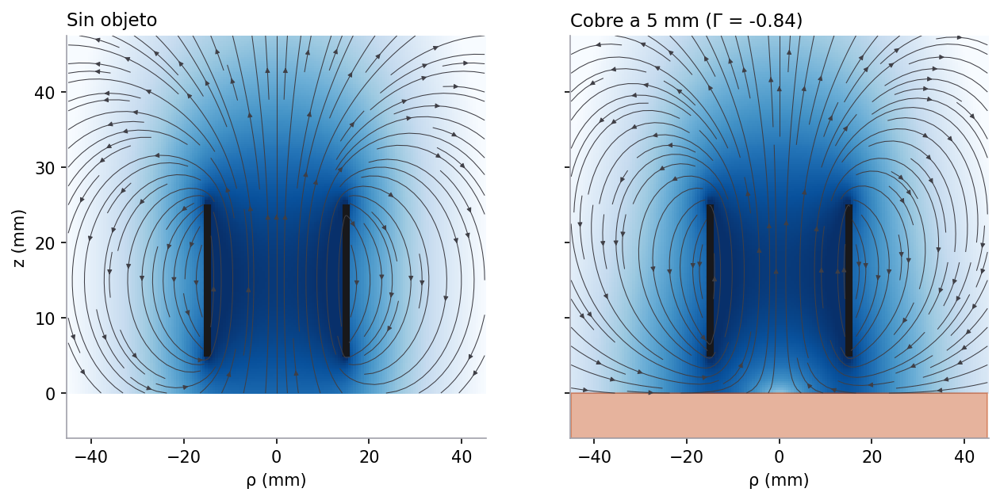

# 6. Validación e impacto

> Criterio de la rúbrica: **Validación e impacto (10 %)**, interpretación física, eficiencia y limitaciones.

El documento cubre los dos escenarios: primero el caso principal (la espira de parqueadero con el Spark y el Kwid,
secciones 6.1 a 6.4) y después la bobina de la línea de autopartes (secciones 6.5 en adelante).

# Caso principal: espira de parqueadero

## 6.1 Validación del modelo del carro

| Comprobación | Resultado esperado | Resultado del modelo |
|---|---|---|
| Inductancia de la espira (1.8 m, 3 vueltas) | regla de instalación: unos 71 µH | 83.0 µH, mismo orden ✓ |
| Efecto del chasis de acero a 55 kHz | la inductancia baja y la frecuencia sube (así funcionan los detectores comerciales) | $\Delta L/L$ = −12.9 % y −11.4 % ✓ |
| Profundidad de penetración frente al espesor de la lámina | $\delta \ll 1$ mm, el acero actúa casi como conductor perfecto | $\delta$ = 0.087 mm ✓ |
| Carro más bajo | más cambio de inductancia | Spark (15 cm) > Kwid (18 cm) ✓ |
| Reconocimiento por altura | cada carro se reconoce | 14.9 cm y 18.0 cm estimados ✓ (prueba automática) |
| Frecuencia del oscilador con RK4 | $f = 1/2\pi\sqrt{LC}$ amortiguada | error de $5\times10^{-6}$ con 40 pasos por período ✓ |
| Energía del oscilador con RK4 | cae como $e^{-Rt/L}$ | 0.0197 frente a 0.0197 en 30 períodos ✓ |
| Cambio de frecuencia simulado | $(1+\Delta L/L)^{-1/2} - 1$ | +7.13 % frente a +7.13 % ✓ (la aproximación lineal daba +6.44 %) |
| Datos de la escena 3D | iguales a los del modelo | ✓ (prueba automática) |
| Líneas de campo bajo el chasis | no lo atraviesan y se acuestan contra él | ✓ (prueba automática y figura de Anatomy) |

**Lo que no se pudo validar:** no tenemos una medición real de un Spark o un Kwid sobre una espira. Como el modelo
trata el chasis como una placa plana infinita, los cambios calculados son un **máximo**: un chasis real tiene huecos,
el túnel de la transmisión y el escape, y cambiaría menos la inductancia. Lo que el modelo sí predice con confianza
es la **tendencia**: un carro más bajo cambia más la inductancia y el cambio crece cuanto mayor es la parte de la
espira que el carro tapa.

## 6.2 Eficiencia y energía del detector

Con 50 mA de amplitud en la espira (valor típico de un detector):

| Magnitud | Valor |
|---|---|
| Energía guardada en la espira $\tfrac12 L_0 I^2$ | 0.10 µJ |
| Potencia que se pierde en la resistencia de la espira $\tfrac12 R_0 I^2$ | 0.75 mW |
| Potencia absorbida por el chasis $\tfrac12\Delta R\, I^2$ | 80 µW (Spark), 67 µW (Kwid) |
| Factor de calidad del oscilador $Q$ | 48 |
| Tiempo para medir la frecuencia con 0.1 % de resolución | unos 18 ms (1 000 ciclos) |

- La espira consume menos de 1 mW (sin contar la electrónica del detector).
- El chasis se lleva cerca del 10 % de la potencia. Esa energía se vuelve calor en la lámina y no tiene ningún
  efecto apreciable en el carro.
- El campo en la espira es de unos 0.09 µT, cientos de veces menor que el de la Tierra: es seguro para las personas
  y no interfiere con nada.

## 6.3 Impacto

**Dónde sirve:**

| Uso | Qué aporta la espira |
|---|---|
| Entrada de parqueaderos | Abre la talanquera sin botón ni tiquete en la mano del conductor; cuenta los cupos ocupados |
| Tarifas por tipo de vehículo | Distingue carros bajos de camionetas por la altura del chasis |
| Semáforos inteligentes | Detecta carros esperando en el pare y ajusta los tiempos |
| Conteo de tránsito | Con dos espiras seguidas se miden la velocidad y el largo de cada vehículo |

**Frente a otras tecnologías:**

| | Espira inductiva | Cámara | Sensor ultrasónico |
|---|---|---|---|
| Funciona de noche, con lluvia o niebla | Sí | Le afecta | Le afecta la lluvia |
| Piezas móviles o expuestas | Ninguna, va enterrada | Lente expuesta | Expuesto |
| Reconoce el modelo exacto | No, solo la altura y el tamaño | Sí (placa, forma) | No |
| Costo de instalación | Hay que cortar el pavimento | Poste y cableado | Bajo |

**Recomendaciones de diseño que salen del estudio de escenarios (05, sección 5.5):**

1. **Espira del tamaño del carro, de 1.5 a 1.8 m.** Ahí la diferencia entre el Spark y el Kwid es máxima (1.5 puntos
   de $\Delta L/L$).
2. **Enterrarla lo menos posible.** A 2 cm hay más señal que a 10 cm, pero hay que protegerla del tránsito; 4 a 7 cm es
   un buen compromiso.
3. **El número de vueltas no cambia el cambio relativo**, solo la frecuencia del oscilador; se elige para que la
   frecuencia quede en el rango del detector.
4. **Para reconocer modelos parecidos hace falta más información:** con dos espiras se mide el largo del carro, que
   sumado a la altura reduce las confusiones.

**Limitaciones del reconocimiento:**

- Un Kwid cargado que baje 2 cm (a 16 cm) se confunde con un Spark.
- Otros carros con alturas parecidas no se distinguen.
- Las motos y bicicletas cambian muy poco la inductancia, porque tienen poco metal y es estrecho: es el problema
  práctico conocido de estos detectores.

## 6.4 Limitaciones frente a un análisis por elementos finitos (caso del carro)

| Limitación del modelo | Qué haría un modelo FEM (COMSOL, FEMM, Elmer) |
|---|---|
| Chasis como placa plana infinita de acero | Geometría real del piso: túnel, largueros, huecos, escape, ruedas de acero |
| Tamaño del carro con un factor de cobertura | Campo 3D con los bordes reales del carro |
| Espira cuadrada como circular de igual área | Esquinas reales de la espira |
| Pavimento sin efecto | Varillas de acero del concreto y cables cercanos, que cambian la inductancia de base |
| Altura fija | Suspensión, carga y movimiento del carro |

El modelo se evalúa en milisegundos y permite ver la escena y los escenarios en vivo; un modelo FEM daría valores
más cercanos a la realidad, pero tardaría minutos por cada posición del carro.

# Segundo escenario: bobina de la línea de autopartes

## 6.5 Validación física del modelo

| Comprobación                            | Resultado esperado               | Resultado del modelo                    |
| ---------------------------------------- | -------------------------------- | --------------------------------------- |
| Sin pieza                                | $L = L_0$, $R = R_0$         | ✓ exacto                               |
| Conductor perfecto ($\sigma\to\infty$) | $\Gamma\to-1$, $L$ disminuye | $\Gamma = -0.99$ a 1 MHz ✓           |
| Ferromagnético a baja frecuencia        | $L$ aumenta                    | +8.4 % a 100 Hz ✓                      |
| Alejar la pieza                          | el efecto tiende a 0             | ✓ (figura de parámetros vs distancia) |
| Energía disipada en la pieza            | $\Delta R > 0$ siempre         | ✓ en los cinco materiales              |
| Escalón DC                              | $i(\tau) = 0.63\,i_{max}$      | ✓ (prueba automática)                 |
| Euler y RK4                              | órdenes 1 y 4                   | 1.01 y 4.02 ✓                          |
| Campo de una espira                      | $B(0) = \mu_0 I/2a$            | ✓ (prueba automática)                 |

En el mapa de campo, con cobre las líneas de $\vec B$ quedan paralelas a la superficie de la pieza: la
componente normal se anula, como exige la condición de frontera de un buen conductor.

## 6.6 Comparación de materiales

Bobina de referencia, $f = 1$ kHz, $d = 5$ mm, umbral del 2 %:

| Material             | $\Delta L/L_0$ | $\Delta R$ (Ω) | Señal $\lvert\Delta I\rvert/I$ | Alcance $S_n$ |
| -------------------- | ---------------- | ----------------- | --------------------------------- | --------------- |
| Acero al carbono     | +5.51 %          | +0.106            | 3.24 %                            | 7.9 mm          |
| Cobre                | −8.45 %         | +0.050            | 2.35 %                            | 6.1 mm          |
| Aluminio             | −8.05 %         | +0.060            | 2.07 %                            | 5.2 mm          |
| Latón               | −6.94 %         | +0.080            | 1.41 %                            | 1.5 mm          |
| Acero inoxidable 304 | −2.71 %         | +0.090            | 0.20 %                            | no se detecta   |

**Comparación con sensores comerciales.** Los fabricantes publican factores de corrección del alcance respecto
al acero: acero 1.0, inoxidable ≈ 0.7, latón ≈ 0.5, aluminio ≈ 0.4 y cobre ≈ 0.3. El modelo acierta en que el
acero es el que se detecta más lejos, pero ordena distinto los no ferrosos. La explicación sale de la
sección 2.6: con la amplitud de corriente como señal, la caída de $L$ y la subida de $R$ se compensan
parcialmente. Los sensores comerciales usan un oscilador LC cuya amplitud depende sobre todo de las
**pérdidas**, es decir, de $\Delta R$. Si se ordena por $\Delta R$, el modelo da inoxidable > latón >
aluminio > cobre, el mismo orden que los fabricantes. Es una validación indirecta del modelo y una
recomendación de diseño: para que el sensor sea casi independiente del metal conviene medir $\Delta R$.

## 6.7 Eficiencia y energía

Con cobre a 5 mm ($I_p = 0.819$ A):

| Magnitud                                                   | Valor                     |
| ---------------------------------------------------------- | ------------------------- |
| Energía magnética máxima $\tfrac12 L I_p^2$           | 183 µJ                   |
| Potencia media total $\tfrac12 R I_p^2$                  | 1.69 W                    |
| Potencia disipada en la pieza $\tfrac12\Delta R\, I_p^2$ | 16.9 mW (1.0 % del total) |

Casi toda la potencia se pierde en el cobre del devanado ($R_0$). Solo un 1 % llega a la pieza, y es esa
fracción la que produce la señal. Los 1.69 W salen de los valores elegidos para ilustrar ($V_0 = 5$ V,
$R_0 = 5\ \Omega$). Un sensor real trabaja con corrientes de miliamperios y consume del orden de mW; el
modelo escala con $V_0^2$.

## 6.8 Impacto en una línea de producción automatizada

El tiempo de respuesta se estima como el tiempo de estabilización del circuito más los ciclos que necesita el
demodulador: $t_r = 5\tau + nT$. Con $\tau = 108\ \mu$s, $f = 1$ kHz y $n = 3$:

| Magnitud                                        | Valor    |
| ----------------------------------------------- | -------- |
| Tiempo de respuesta                             | 3.54 ms  |
| Frecuencia de conmutación máxima $1/(2t_r)$ | 141 Hz   |
| Piezas por minuto                               | ≈ 8 500 |
| Velocidad máxima de la banda (pieza de 30 mm)  | 8.5 m/s  |

Subir la frecuencia de alimentación acorta $t_r$ (a 10 kHz, $t_r \approx 0.84$ ms), pero reduce $\delta$ y
cambia la respuesta a los materiales ferrosos. Es una decisión de diseño entre velocidad y selectividad. En
control de calidad, la diferencia de señal entre materiales permite separar piezas de acero de piezas no
ferrosas con un solo sensor y dos umbrales.

## 6.9 Limitaciones frente a un análisis por elementos finitos (FEM)

| Limitación del modelo             | Qué haría un modelo FEM (COMSOL, FEMM, Elmer)                                             |
| ---------------------------------- | ------------------------------------------------------------------------------------------- |
| Pieza como semiespacio infinito    | Geometría real: piezas pequeñas, delgadas (espesor < 3δ) o con bordes acoplan menos      |
| Bobina de capa delgada sin núcleo | Núcleo de ferrita en copa, que concentra el campo en la cara activa y aumenta el alcance   |
| Materiales lineales                | Saturación, histéresis magnética, dependencia de $\mu_r$ con el campo y la temperatura |
| Régimen cuasi-estático           | Capacitancia entre espiras y resonancia propia de la bobina                                 |
| Movimiento axial y lento           | Paso lateral de la pieza, velocidad alta y efectos de movimiento ($\vec v\times\vec B$)   |
| Electrónica idealizada            | Oscilador LC real, ruido, deriva térmica                                                   |

A cambio, el modelo es **semianalítico**: se evalúa en milisegundos y permite barrer parámetros en vivo. Con
FEM cada punto tardaría minutos. Como herramienta de diseño preliminar y de enseñanza, el compromiso es
adecuado.

## 6.10 Comprobaciones adicionales del modelo

| Comprobación                                               | Resultado                                                                        |
| ----------------------------------------------------------- | -------------------------------------------------------------------------------- |
| Flujo por espira con campo uniforme, $L\approx N\Phi_B/i$ | 0.55 mH frente a 0.60 mH de Wheeler (diferencia por la no uniformidad del campo) |
| Campo lejano frente a dipolo $\mu_0 2m/4\pi z^3$          | razón 0.99 a 8 radios ✓                                                        |
| Balance de energía al energizar                            | error $5\times10^{-7}$ ✓                                                      |
| Ejercicio RC de clase con el mismo código                  | $\tau = 12$ s, $q_{max} = 1.8$ mC, RK4 con error $6\times10^{-10}$ C ✓    |
| Cambio relativo de $L$ independiente de $N$             | −8.45 % para cualquier $N$ ✓ (las dos crecen con $N^2$)                    |

## 6.11 Recomendaciones de diseño que salen del modelo

1. **Aumentar el radio antes que la corriente.** El alcance escala con el radio ($S_n/a \approx 1$ en bobinas
   grandes) porque el campo cae como $1/z^3$. Más corriente no cambia la forma de esa caída.
2. **Factor de calidad alto.** Alambre grueso o más espiras para que $\omega L \gg R$. Con $Q < 0.5$ casi no hay señal.
3. **Frecuencia entre 2 y 10 kHz para metales mixtos.** En ese rango el cobre ya está cerca de su máximo y el acero
   todavía se detecta. Hay que evitar la frecuencia ciega del acero (~20 kHz).
4. **Medir pérdidas ($\Delta R$) en lugar de la amplitud** si se necesita detectar todos los metales de forma
   parecida, como hacen los osciladores LC comerciales.
5. **Usar histéresis.** Evita que la salida parpadee cuando la pieza se queda cerca del umbral.

## 6.12 Aplicaciones

El apunte de clase pide consultar aplicaciones del circuito RC. Estas son las del principio inductivo que modelamos:

| Aplicación                                        | Cómo usa el mismo principio                                                                  |
| -------------------------------------------------- | --------------------------------------------------------------------------------------------- |
| Conteo y posicionamiento de piezas en bandas       | El segundo escenario simulado                                                                 |
| Medición de velocidad de engranajes (RPM)         | Cada diente que pasa frente a la bobina es una pieza; la frecuencia de pulsos da la velocidad |
| Detectores de metales y de minas                   | Bobina grande (alcance ∝ radio) y medición de $\Delta Z$                                  |
| Lazos inductivos en semáforos y parqueaderos      | El caso principal simulado: una espira enterrada en el pavimento detecta el chasis del carro |
| Validadores de monedas                             | La frecuencia y la amplitud de $\Delta Z$ identifican la aleación de la moneda             |
| Ensayos no destructivos por corrientes de Foucault | Una grieta interrumpe las corrientes y cambia $\Delta Z$; se usa en aviones y tuberías     |
| Cocinas de inducción y frenos magnéticos         | La misma física, pero buscando el calor ($\Delta R$) en vez de la señal                   |

## 6.13 Comparación con otras tecnologías de detección

|                         | Inductivo                      | Capacitivo (visto en clase)              | Óptico                |
| ----------------------- | ------------------------------ | ---------------------------------------- | ---------------------- |
| Detecta                 | Solo metales                   | Metales, plásticos, líquidos, personas | Cualquier objeto opaco |
| Alcance típico         | 1 – 40 mm                     | 1 – 30 mm                               | centímetros a metros  |
| Polvo, aceite, suciedad | No le afectan                  | Le afectan                               | Le afectan mucho       |
| Costo y robustez        | Bajo y muy robusto             | Bajo                                     | Medio                  |
| Uso típico             | Piezas metálicas en máquinas | Nivel de líquidos, pantallas            | Cajas en bandas        |

## 6.14 Fuentes de error del modelo

| Fuente                               | Efecto esperado                                                                                      |
| ------------------------------------ | ---------------------------------------------------------------------------------------------------- |
| $\sigma$ y $\mu_r$ tabulados     | El acero real tiene $\mu_r$ entre 50 y 1000 según la aleación; cambia mucho el resultado ferroso |
| Fórmula de Wheeler                  | Error cercano al 1 % en $L_0$                                                                      |
| Malla de integración de Dodd–Deeds | Error relativo de 1.3×10⁻⁶ frente a una malla diez veces más fina                                |
| Paso temporal                        | Controlado: RK4 con 40 pasos por ciclo da $10^{-5}$ A de error                                     |
