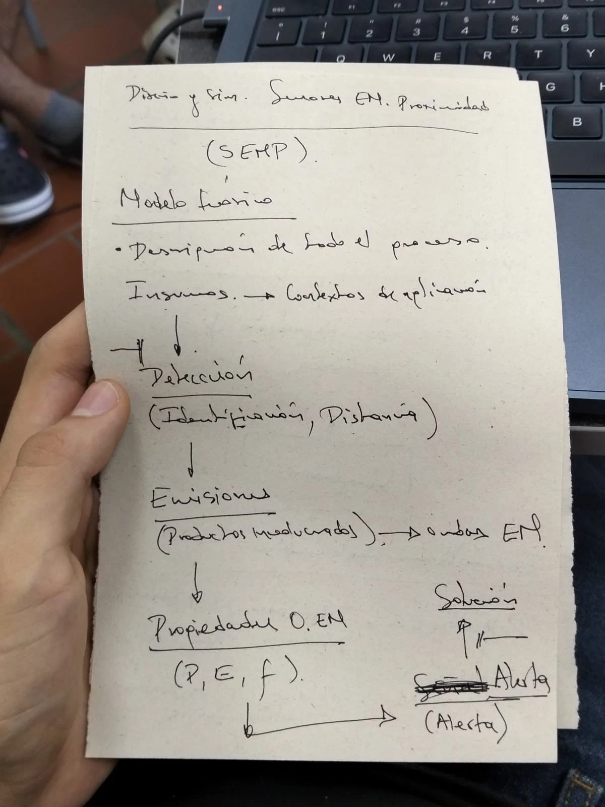
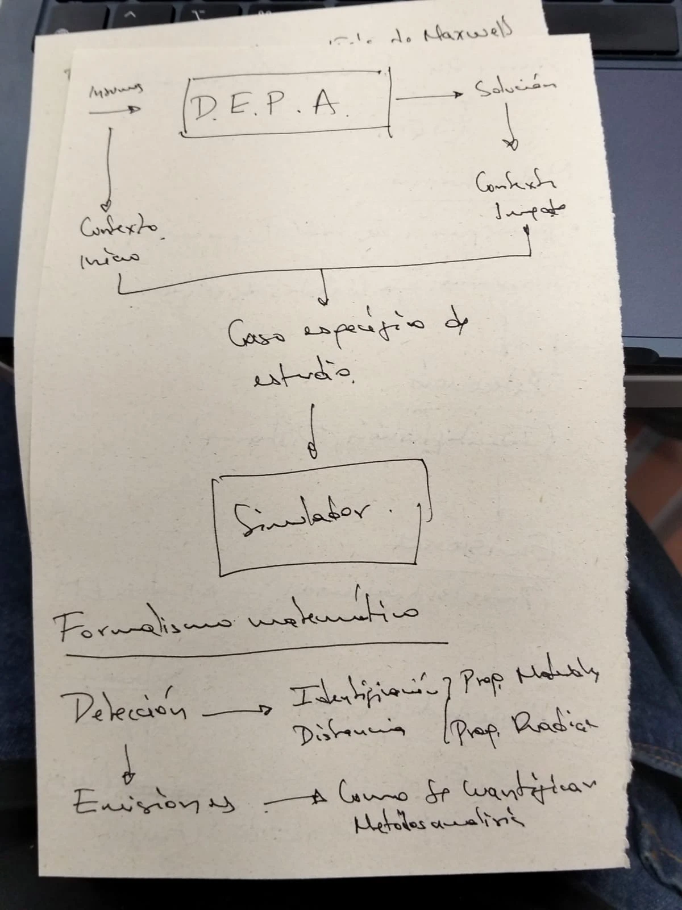
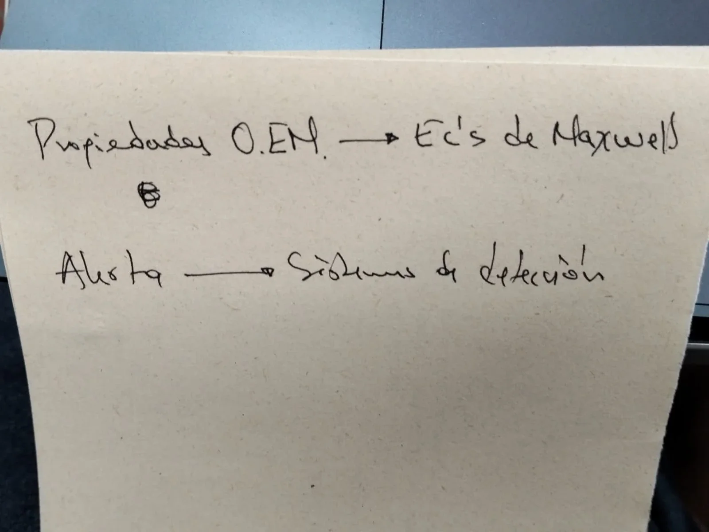

# Orientación del profesor: esqueleto del proyecto SEMP

Resumen de la explicación dada en clase (notas a mano y audios del 10 de noviembre de 2026). El proyecto se
llama **SEMP**: Sensores ElectroMagnéticos de Proximidad.

| Notas | |
|---|---|
|  |  |
|  | |

## La idea: describir el proceso por etapas

El profesor lo compara con el espectrómetro de masas visto en clase: primero se identifican las partes del
aparato (acelerador, campo, deflexión) y después se ve qué matemática necesita cada parte (conservación de la
energía, fuerza, deflexión). Así la matemática queda **delimitada**: solo se usa la que cada etapa necesita.

## Parte 1: modelo teórico

```
 Insumos ──► [ D · E · P · A ] ──► Solución
    │                                 │
 contexto de inicio            contexto de impacto
    └──────────────┬──────────────────┘
                   ▼
          caso específico de estudio
                   ▼
               Simulador
```

1. **Insumos: contextos de aplicación.** En qué situaciones importan los sensores de proximidad (parqueaderos,
   identificación de metales, líneas de producción). Leer sobre ellos da el **contexto de inicio**: qué problema
   se va a mirar.
2. **La caja D.E.P.A.**, que es el cuerpo del proyecto:
   - **D · Detección:** qué hay que detectar. Dos cosas: **identificación** (tipo de material) y **distancia**
     (depende del tipo de aplicación). Ejemplo del profesor: una línea de producción de autopartes por la que
     pasan tornillos, cables y otras piezas de distintos metales, y el sensor debe saber de qué metal es cada una.
   - **E · Emisiones:** la respuesta de los productos involucrados, ligada a las ondas electromagnéticas. Unos
     materiales responden a unas cosas y otros no.
   - **P · Propiedades de las ondas electromagnéticas:** energía, frecuencia y potencia.
   - **A · Alerta:** lo que entrega el sensor. Mejor llamarlo alerta o tope que "señal", para no confundir.
3. **Solución: contexto de impacto.** Hasta dónde se quiere llegar.
4. **Caso específico de estudio:** sale de unir el contexto de inicio con el de impacto, y es el que va al
   **simulador**, para ver con todos los parámetros de entrada qué tan eficiente es la solución.

## Parte 2: formalismo matemático por etapa

| Etapa | Qué matemática se busca |
|---|---|
| **Detección** → identificación y distancia | Propiedades de los **materiales** y propiedades de la **radiación**. Con la frecuencia se identifica el material; con la potencia se establecen distancias (a qué distancia es más o menos intensa). |
| **Emisiones** → cómo se cuantifican | Métodos de análisis: cómo se detectan y se miden, cuántos materiales hay, cómo se sabe que hay una **impureza** que después puede causar problemas. |
| **Propiedades de las ondas EM** → ecuaciones de Maxwell | Solo las ecuaciones que hagan falta. Si una sola contiene lo necesario, solo esa se discute. |
| **Alerta** → sistemas de detección | Cómo el sistema convierte la medición en una alerta. |

## Cómo quedó aplicado en el proyecto

El documento [00 · Modelo teórico y formalismo (D.E.P.A.)](../00-modelo-teorico-depa.md) sigue este esqueleto
y remite a los documentos 01 a 06 para el detalle. El simulador tiene una pestaña **Identificación** con el caso
de estudio de la línea de autopartes.

## Indicación del 12 de noviembre: el carro

En la clase del 12 de noviembre el profesor sugirió llevar el sensor a un vehículo para que el simulador sea más
concreto que cambiar valores: *"pon un Spark, y que se pueda cambiar también a un Kwid, y lo probamos con esos dos
carros en el simulador"*. Como referencia visual se tomó el simulador de otro equipo, que muestra el sistema
completo en 3D con etiquetas de potencia en cada parte.

Cómo se aplicó: el caso principal pasa a ser una **espira de detección en el piso de un parqueadero** que reconoce
si el carro es un Chevrolet Spark GT o un Renault Kwid por la altura de su chasis
([00 · Modelo teórico](../00-modelo-teorico-depa.md#02-caso-específico-de-estudio)). El plan del simulador 3D está en
[plan-simulador-3d.md](../plan-simulador-3d.md).
